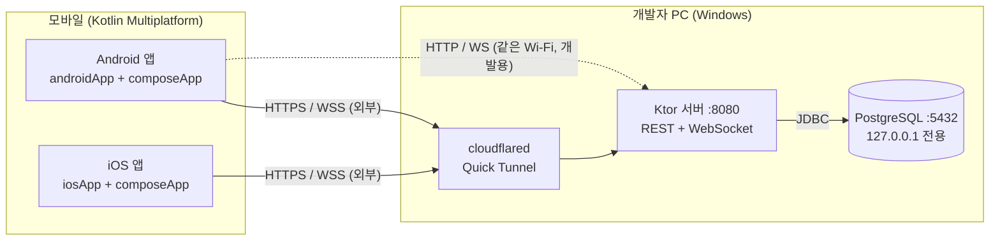
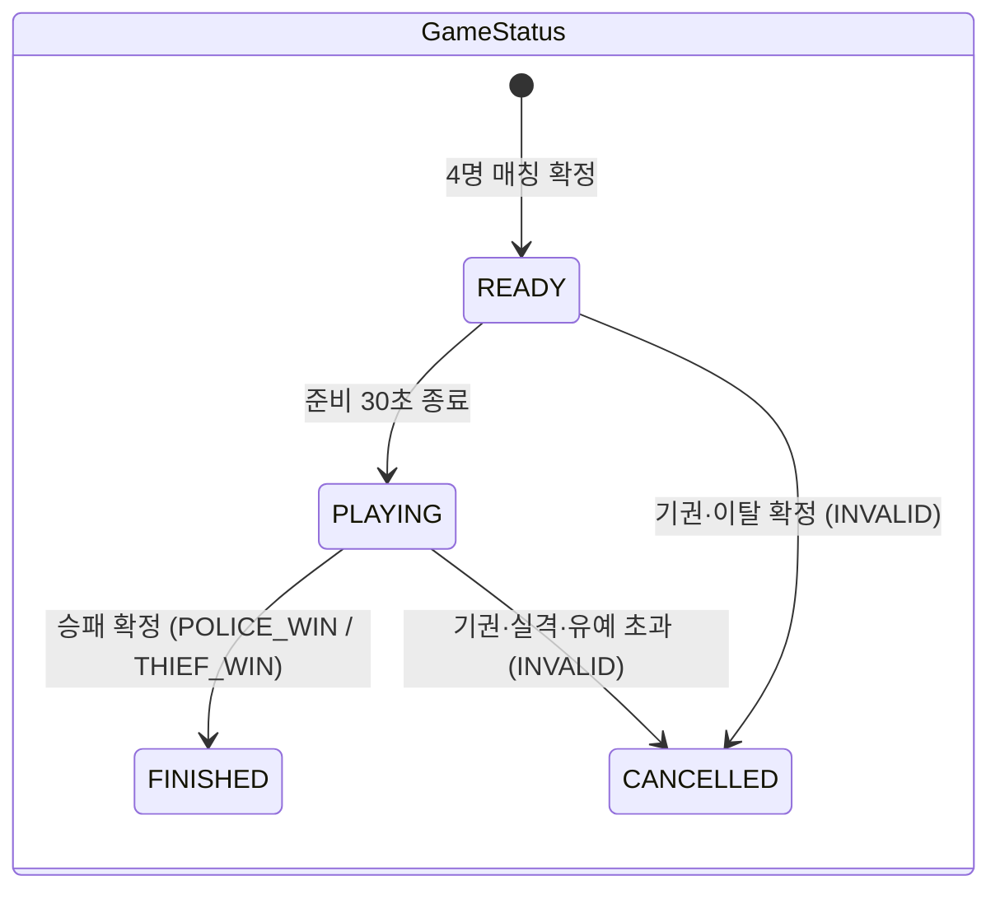
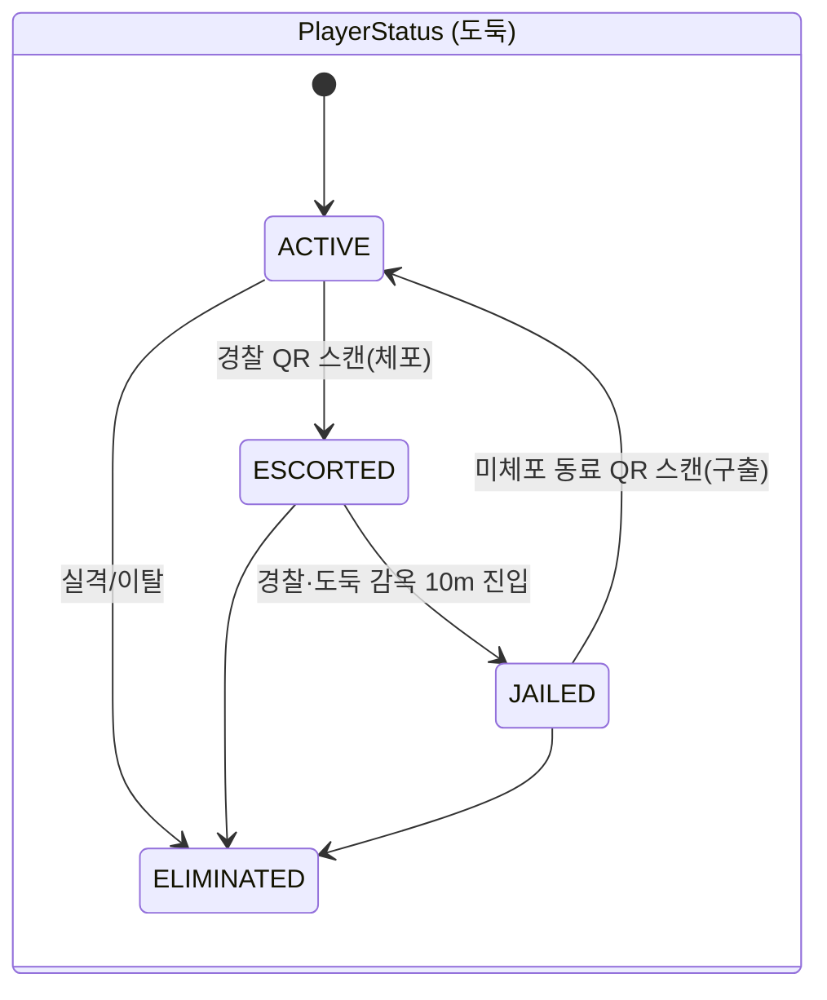
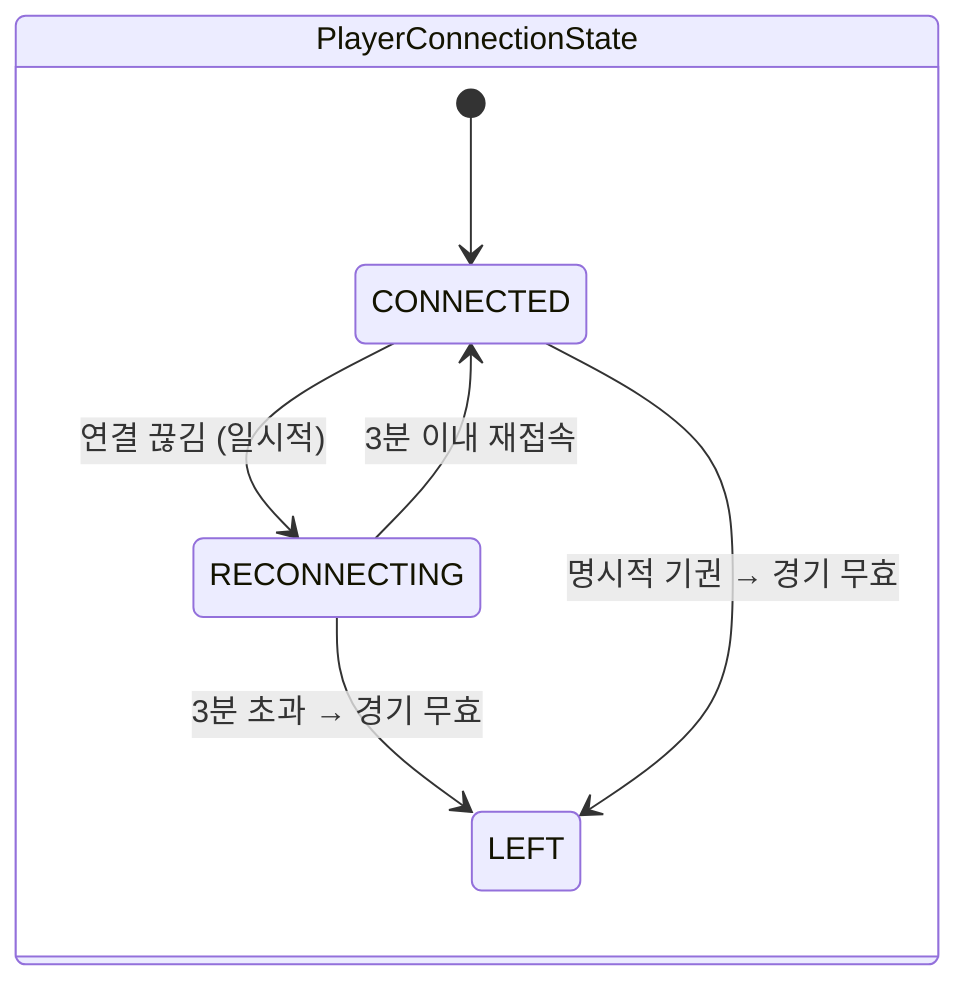
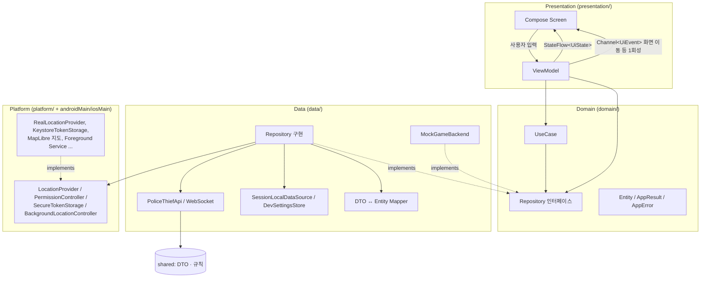
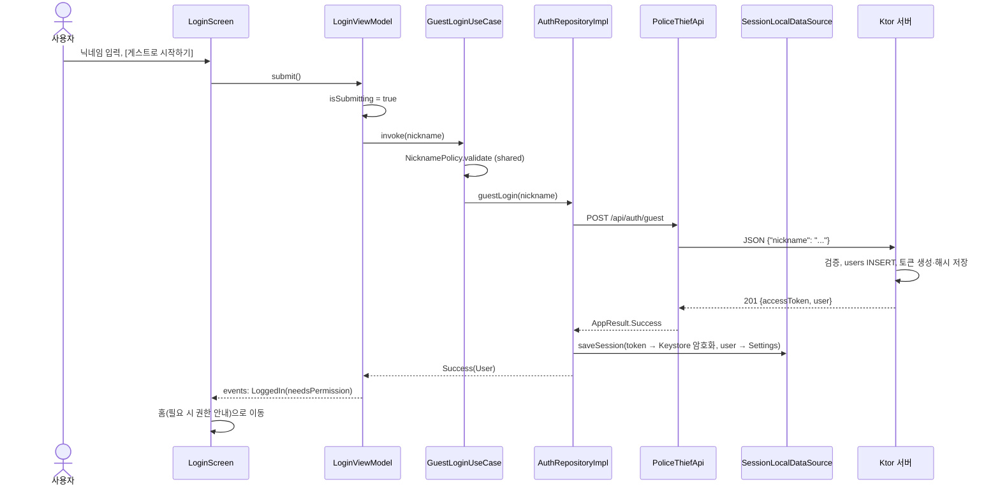
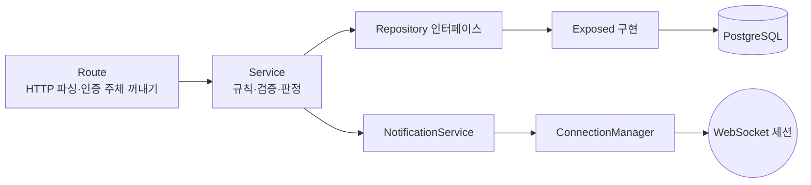

# ARCHITECTURE — 전체 구조

## 1. 클라이언트–서버 구조

- 모든 게임 판정(매칭, 역할 배정, 체포, 수감, 구출, 승패, 실격)은 **서버**가 한다. 앱은 서버가 확정한 결과만 표시한다.
- 외부 공개는 Ktor 서버(8080)만 Cloudflare Tunnel 로 한다. DB 포트는 `127.0.0.1` 에만 열고 절대 공개하지 않는다.
- 서버 주소는 빌드 설정(`local.properties`, `Config.xcconfig`)과 개발 빌드의 설정 화면에서 바꾼다(하드코딩 없음).

## 2. 확정된 게임 규칙 (코드: `shared/.../rules/GameRules.kt`)

| 항목 | 값 | 비고 |
|---|---|---|
| 인원 / 역할 | 4명, 경찰 2 · 도둑 2 | 서버 무작위 배정 |
| 매칭 | 반경 500m, 최대 10분 | |
| 준비 시간 | 30초 | 역할 공개 + 구역 확인 |
| 게임 구역 | 4명 위치 중심, 반경 500m | 축소는 TODO |
| 감옥 | 구역 중심, 반경 10m | 호송 경찰·도둑 모두 진입 시 수감 |
| 제한 시간 | 30분 | 생존 시 도둑 승리 |
| 위치 갱신 | 약 15초 | OS 제한으로 보장 안 됨 |
| 위치 공개 | 경찰: 전원 / 도둑: 도둑끼리 | 준비 단계(S-07)는 4명 최초 위치 공개 |
| 체포 / 호송 | 경찰이 도둑 QR 스캔, 경찰 1명당 1명 | |
| 구출 | 미체포 도둑이 수감 도둑 QR 스캔 | 호송 중 구출 불가 |
| 경찰 승리 | 마지막 도둑 체포 즉시 | 수감 여부와 무관 |
| 기권·실격 | 즉시 종료, 무효(INVALID) | |
| 연결 끊김 | 3분 재접속 유예 | 초과 시 이탈 확정 → 무효 |
| QR | 경기별 고정 토큰 | 서버가 경기·소유자 대조 |

### 상태 모델 (경기 상태 ≠ 플레이어 상태 ≠ 접속 상태)

명시적 기권(POST `/forfeit`)은 즉시 `LEFT`, 일시적 끊김은 `RECONNECTING` 으로 구분한다.

## 3. 모바일 아키텍처: Clean Architecture + MVVM

### 계층별 역할

| 계층 | 위치 | 책임 | 하지 않는 것 |
|---|---|---|---|
| Presentation | `presentation/*` | 화면 그리기, 입력 전달, UiState 보관 | 서버/DB 직접 호출, 플랫폼 SDK 호출 |
| Domain | `domain/*` | Entity, Repository 계약, UseCase(검증·조합 규칙) | Ktor·Compose·Android 의존 |
| Data | `data/*` | API 호출, 로컬 저장, DTO 변환, 오류 → `AppError` 변환 | UI 상태 관리 |
| Platform | `platform/*`(인터페이스) + `androidMain`/`iosMain`(구현) | GPS, 권한, 보안 저장소, 지도, QR, 백그라운드 | 비즈니스 규칙 |
| DI | `di/AppModules.kt` | 객체 조립, Mock ↔ 실제 교체 | |

### 의존성 방향

`presentation → domain ← data`, `data → platform(인터페이스)`, `androidMain/iosMain → platform(구현)`.
Domain 은 `shared.model`(상태 enum) / `shared.rules`(규칙) 만 의존하고 `shared.dto` 는 의존하지 않는다. DTO 는 Data 계층의 Mapper 에서만 다룬다.

### MVVM 상태 흐름

1. Screen 이 `viewModel.uiState.collectAsStateWithLifecycle()` 로 상태를 구독한다.
2. 버튼 → `viewModel.submit()` 같은 함수 호출.
3. ViewModel 이 `viewModelScope.launch { useCase() }` 로 비동기 작업 후 `MutableStateFlow` 를 갱신.
4. 화면 이동처럼 한 번만 일어나야 하는 일은 `Channel` 기반 `events` 로 보낸다(회전 시 중복 이동 방지).
5. 모든 Repository/UseCase 는 예외 대신 `AppResult.Success / Failure(AppError)` 를 돌려주어 ViewModel 이 `when` 으로 모든 경우를 처리한다.

## 4. 데이터 흐름 예시 — 게스트 로그인

다음 실행 시 `LaunchViewModel` → `RestoreSessionUseCase` → `GET /api/users/me` 로 토큰을 확인한다. 401 이면 토큰 삭제 후 로그인 화면, 네트워크 오류면 저장된 프로필로 **오프라인 복구**한다.

## 5. 서버 아키텍처: 모듈형 모놀리스

하나의 Ktor 애플리케이션 안에서 기능 영역을 패키지로 나눈다(마이크로서비스 아님).

| 영역 | 패키지 | 상태 |
|---|---|---|
| Authentication | `server/auth` (AuthRoutes, AuthService, UserRepository, AuthTokenRepository) | 구현 |
| Location | `server/location` (LocationRoutes, LocationService, LocationRepository) | 구현(저장·검증) |
| Event | `server/event` (RealtimeRoutes `/ws`, ConnectionManager) | 구현(연결·테스트 이벤트) |
| Notification | `server/notification` (WebSocketNotificationService) | WebSocket 전송만 구현, 푸시 TODO |
| Matchmaking / Game / Capture / Rescue / QR | `server/game` (인터페이스 + `NotImplemented*` + GameRoutes) | 계약만, 501 응답 |
| 공통 | `config`, `database`(Flyway·Exposed·Tables), `plugins`(인증·오류·직렬화·WebSocket), `common`(예외) | 구현 |

- 의존성 주입: 프레임워크 없이 `ServerDependencies`(Application.kt)에서 생성자로 조립한다. 새 기능을 구현하면 `NotImplemented...` 자리만 실제 구현으로 바꾸면 된다.
- 인증: `Authorization: Bearer <token>`. 서버는 토큰의 SHA-256 해시로 `auth_tokens` 를 조회한다(JWT 서명 키 불필요). WebSocket 도 같은 인증 블록 안에 있어 업그레이드 요청에서 토큰을 검증한다.
- 오류: 모든 실패는 `ErrorResponse{code,message,details}` JSON 으로 통일(StatusPages). 내부 예외 메시지는 노출하지 않는다.
- 스키마: Flyway SQL(`server/src/main/resources/db/migration`)만이 기준이다.

## 6. 플랫폼별 구현 차이

| 기능 | Android | iOS | 공통 인터페이스 |
|---|---|---|---|
| GPS | Fused Location Provider 1회 고정밀 요청 | Core Location `requestLocation` | `LocationProvider` |
| 테스트 좌표 | `MockLocationProvider` (개발 빌드만) | 동일 | `DevAwareLocationProvider` |
| 권한 | ActivityResult API, 설정 화면 Intent | CLLocationManager / AVCaptureDevice / UNUserNotificationCenter | `PermissionController`, `rememberPermissionRequester` |
| 토큰 보안 저장 | Android Keystore AES-256-GCM + SharedPreferences | Keychain (KeychainSettings) | `SecureTokenStorage` |
| 일반 설정 저장 | SharedPreferences | NSUserDefaults | `Settings` |
| 지도 | MapLibre Native + OpenFreeMap dark | **도식 지도(SchematicMap)** — MapLibre iOS/MapKit TODO | `PlatformMapView` / `GameMap` |
| QR 이미지 | ZXing → Compose Canvas | **TODO** (토큰 문자열 표시) | `QrCodeImage` |
| QR 스캔(카메라) | **TODO** (CameraX + ML Kit) | **TODO** (AVFoundation) | Mock 스캔 버튼 |
| 백그라운드 위치 | Foreground Service (type=location), 15초 루프 | **TODO** (UIBackgroundModes=location) | `BackgroundLocationController` |
| 뒤로가기 확인(D-01/D-02) | `BackHandler` | 시스템 뒤로가기 없음 → [나가기] 버튼 | `PlatformBackHandler` |
| HTTP 엔진 | OkHttp | Darwin | `HttpClientEngine` |

## 7. 지도 타일 공급원 검토

| 후보 | 비용 | 국내 지도 | 판단 |
|---|---|---|---|
| **OpenFreeMap** (채택) | 무료, API 키·가입 없음, 요청 수 제한 없음(공식 안내) | OSM 기반, 대한민국 도로·건물 표시 | 출처 표시 필수: "© OpenFreeMap © OpenMapTiles © OpenStreetMap contributors" (앱 지도 하단·설정 화면에 표시). 무보증(as-is) 서비스라 장애 시 도식 지도로 자동 대체 |
| MapLibre demotiles | 무료 | 저해상도 세계 지도뿐 | 게임용 부적합 |
| OSM 공식 타일 서버 | 무료 | 가능 | 앱의 대량 사용 금지 정책 → 부적합 |
| 네이버/카카오 지도 SDK | 무료 할당량 있음(가입·키 필요) | 국내 최적 | 대체 후보. MapLibre 가 불가하면 `PlatformMapView` 만 교체 |

2026-11-13 에 `https://tiles.openfreemap.org/styles/dark` 응답(정상)과 OpenFreeMap 홈페이지·약관을 확인했다. 운영 전 약관을 다시 확인할 것.

## 8. 외부 접속 (Cloudflare Tunnel)

개발 PC 의 서버를 외부 휴대폰에서 쓰려면 `cloudflared tunnel --url http://localhost:8080` (Quick Tunnel) 을 실행해 `https://<임의>.trycloudflare.com` 을 얻는다. Cloudflare 문서상 Quick Tunnel 은 **테스트·개발용**이며, URL 을 아는 누구나 접근할 수 있고, `cloudflared` 를 끄면 URL 이 사라지며 다시 켜면 바뀐다. 앱은 HTTPS/WSS 로 접속하고, URL 이 바뀌면 개발 빌드의 설정 화면이나 `local.properties` 만 수정하면 된다. 절차와 주의사항: [SERVER_SETUP.md](../development/SERVER_SETUP.md).
