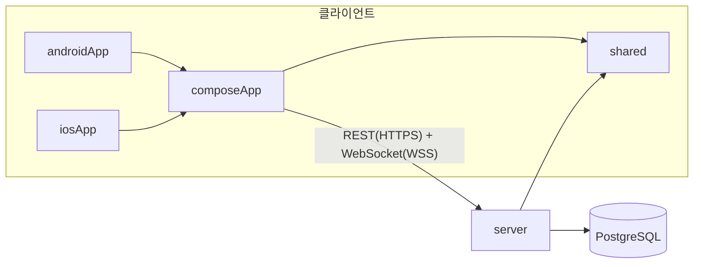
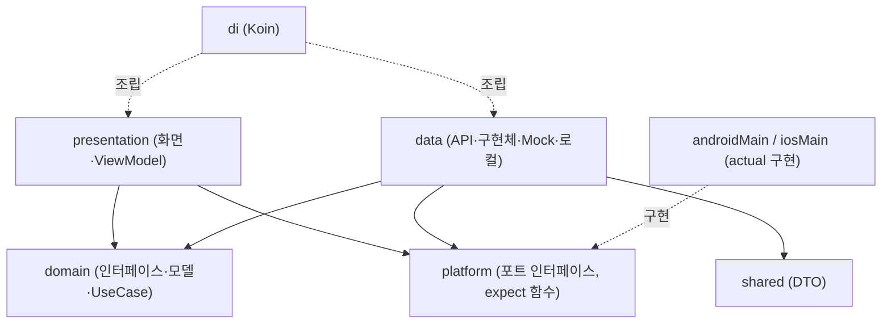
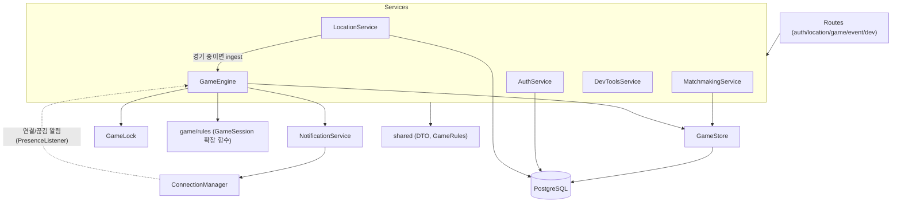
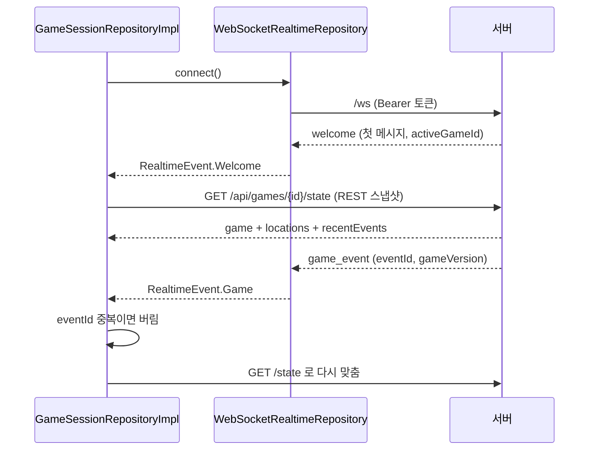

# ARCHITECTURE — 전체 구조

이 문서는 **현재 코드가 실제로 어떻게 나뉘어 있고 서로 어떻게 의존하는지**를 설명한다. 코드를 읽기 전에 지도처럼 보는 용도다.
세부 파일·함수는 [`CODE_GUIDE.md`](../development/CODE_GUIDE.md), 영역별 분담은 [`TEAM_ANALYSIS_GUIDE.md`](../development/TEAM_ANALYSIS_GUIDE.md), 게임 규칙은 [`GAME_LOGIC.md`](../development/GAME_LOGIC.md), DB는 [`DATABASE.md`](DATABASE.md), 통신 계약은 [`API.md`](../api/API.md) 를 본다.

> **검증 범위**: 서버·공유 규칙·앱 공통 로직은 자동 테스트(총 137개 통과: shared 17, server 75, composeApp 42, androidApp 3)와 실제 Ktor 프로세스 + PostgreSQL 16.4 로 4인 시나리오 40항목(서버 재시작 복구 포함)을 확인했다. **실기기, iOS 빌드, Cloudflare Tunnel, GitHub Actions 는 검증하지 않았다.**

## 1. 모듈 구성

| 모듈(폴더) | 역할 | 비고 |
|---|---|---|
| `shared/` | 앱과 서버가 **함께 쓰는** 계약: API 경로(`api/ApiPaths.kt`), DTO(`dto/*.kt`), enum(`model/GameEnums.kt`), 확정 규칙 상수(`rules/GameRules.kt`), 거리 계산(`geo/GeoMath.kt`), 닉네임·위치 검증(`rules/NicknamePolicy.kt`, `rules/LocationValidator.kt`) | Kotlin Multiplatform(commonMain 만). 앱·서버가 같은 JSON 형식을 보장 |
| `server/` | Ktor 서버 + PostgreSQL(Exposed, Flyway). 모든 게임 판정의 주체 | JVM |
| `composeApp/` | 앱의 **공통 코드**(Compose Multiplatform UI, ViewModel, 통신, 상태 동기화) + 플랫폼별 코드(`androidMain`, `iosMain`) | KMP 라이브러리 |
| `androidApp/` | Android 실행 앱: `MainActivity`, `PoliceThiefApplication`(Koin 시작), Manifest, BuildConfig | composeApp 을 가져다 실행 |
| `iosApp/` | Xcode 프로젝트(SwiftUI → `MainViewController` 호출) | **빌드 미검증**(macOS 필요) |

핵심 원칙 두 가지:

1. **서버가 판정한다.** 체포·구출·수감·구역 이탈·과속·승패는 모두 서버(`server/.../game/`)가 정한다. 앱은 위치를 보내고, 서버가 알려 준 상태를 그린다. 앱이 "이벤트 내용으로 상태를 추측"하지 않는다(이벤트를 받으면 `GET /state` 로 다시 받는다).
2. **계약은 `shared/` 한 곳.** 앱과 서버가 같은 DTO·경로·상수를 import 하므로 필드 이름이 어긋나지 않는다. 그래서 `GameRules`(확정값)를 바꾸면 앱·서버가 함께 바뀐다.

## 2. 앱(composeApp) 계층 구조

패키지는 `composeApp/src/commonMain/kotlin/com/nettwork/policethief/` 아래에 있다.

| 패키지 | 계층 | 내용 |
|---|---|---|
| `presentation/` | Presentation | Compose 화면(`*Screen`), ViewModel, 내비게이션(`navigation/Routes.kt`, `AppNavHost.kt`), 공용 컴포넌트, 테마 |
| `domain/` | Domain | `model/`(앱 내부 모델, `AppResult`), `repository/Repositories.kt`(**인터페이스**), `usecase/UseCases.kt` |
| `data/` | Data | `remote/`(Ktor 클라이언트 `PoliceThiefApi`, WebSocket), `repository/`(인터페이스 구현), `mapper/DtoMappers.kt`(DTO→도메인), `local/`(저장소), `mock/MockGameBackend.kt`(서버 없이 화면 확인용) |
| `platform/` | 플랫폼 경계 | `PlatformContracts.kt`(인터페이스), `PlatformComposables.kt`·`map/GameMap.kt`(`expect` 함수), `location/LocationProviders.kt`, `GameAlertDispatcher.kt` |
| `di/` | 조립 | `AppModules.kt`(Koin) |
| `core/`, `config/` | 공통 | `EpochClock.kt`(시계, `ServerClock`), `AppConfig.kt` |

의존 방향은 **Presentation → Domain ← Data** 이다. Domain 은 아무것도 모르는 가운데 층이고, Data 가 Domain 의 인터페이스를 구현한다.

### 2-1. "Presentation 은 data 구현체를 참조하지 않는다" — 실제 확인 결과

`presentation/` 의 import 를 검색해 확인했다.

| 항목 | 결과 |
|---|---|
| Presentation → `data.remote`, `data.repository`, `data.mock` | **없음.** ViewModel 은 `domain.repository` 인터페이스만 쓴다(Mock 도 `MockGameController` 인터페이스로 접근). |
| Presentation → `data.local` | **없음.** 설정은 domain 인터페이스 `DevSettingsRepository`·`UserPreferencesRepository`·`ServerAddressProvider`(`domain/repository/SettingsRepositories.kt`)와 모델 `DevSettings`·`UserPreferences`(`domain/model/Preferences.kt`)로 받는다. 구현(`DevSettingsStore`, `UserPreferencesStore`, `ServerUrlProvider`)은 `data/local/LocalStores.kt` 에 있고 `di/AppModules.kt` 에서 연결한다. `platform/` 의 `GameAlertDispatcher`·`LocationProviders` 도 같은 인터페이스를 쓴다. |
| Presentation → `platform` | 있음. 인터페이스(`PermissionController`, `BackgroundLocationController`)와 `expect` 컴포저블(`QrScannerView`, `QrCodeImage`, `GameMap`, `PlatformBackHandler`)을 쓴다. 이 둘은 commonMain 의 "포트"라서 구조상 허용되는 의존이다. |
| 역방향 | `data`·`domain` → `presentation`: **없음.** 단 `platform/map/GameMap.kt` 가 `presentation.theme.AppColors` 를 import 한다(platform 이 presentation 테마를 참조). |
| Domain → data/platform/presentation | **없음.** Domain 은 순수하게 유지된다. |
| Data → platform | 있음(`GameSessionRepositoryImpl` 이 `BackgroundLocationController`, `LocationRepositoryImpl` 이 `LocationProvider`). 인터페이스만 참조하므로 정상. |

정리: Presentation 은 `data` 패키지를 하나도 import 하지 않는다(DI 모듈과 테스트만 구현체를 안다). 다만 UseCase 는 4개(`GuestLoginUseCase`, `RestoreSessionUseCase`, `CheckServerStatusUseCase`, `ShareCurrentLocationUseCase`)뿐이고, 경기 관련 화면의 ViewModel 은 UseCase 없이 Repository 를 직접 쓴다(코드와 일반적인 Clean Architecture 설명이 다른 점).

### 2-2. MVVM

- **View**: `@Composable` 함수(`HomeScreen`, `GameMapScreen`, …). 상태를 그리고 사용자 입력을 ViewModel 에 전달만 한다.
- **ViewModel**: `androidx.lifecycle.ViewModel` 상속(`HomeViewModel`, `GameMapViewModel` 등). `StateFlow` 로 UI 상태를 내보낸다.
- **Model**: `domain.model` 의 데이터 클래스와 Repository 가 주는 값.

흐름: 버튼 클릭 → ViewModel 함수 → (UseCase) → Repository 인터페이스 → Data 구현 → `PoliceThiefApi`(HTTP) → 서버. 응답은 `AppResult.Success/Failure` 로 감싸져 올라온다(예외를 던지지 않는 방식).

### 2-3. 의존성 주입(Koin) — `di/AppModules.kt`

`commonModule(config)` 한 곳에서 모든 객체를 만든다. 플랫폼 모듈(`androidPlatformModule`, `iosPlatformModule`)은 다음을 제공해야 한다: `HttpClientEngine`, `Settings`, `SecureTokenStorage`, `PermissionController`, `BackgroundLocationController`, `GameAlerts`, 실제 `LocationProvider`(`REAL_LOCATION_PROVIDER` 이름표).

- `single { … }`: 앱 전체에서 하나(Repository, `ServerClock`, `PoliceThiefApi`, `GameSessionRepository`, 앱 전체 `CoroutineScope`).
- `factory { … }`: 쓸 때마다 새로(UseCase).
- `viewModel { … }`: 화면 생명주기에 맞는 ViewModel. `gameId` 같은 값은 `params.get()` 으로 받는다.
- `GameAlertDispatcher` 는 `createdAtStart = true` 로 앱 시작 때부터 알림을 듣는다.
- **Mock ↔ 실제 교체 지점**: `isMockGame()`(= 개발 빌드이고 설정에서 "서버 없이 Mock 경기" 를 켠 경우)가 참이면 `MatchmakingRepository`/`GameRepository` 가 `MockGameBackend` 가 되고, 아니면 `RemoteMatchmakingRepository`/`RemoteGameRepository` 가 된다. 화면 코드는 바뀌지 않는다.
- 시작: Android `PoliceThiefApplication` 이 `initKoin(config, androidPlatformModule(context))` 호출, iOS 는 `startKoinForIos()`(`iosMain/MainViewController.kt`).

## 3. 공통 코드 vs 플랫폼 코드

공통(`commonMain`)이 **인터페이스 또는 `expect`** 를 선언하고, `androidMain`/`iosMain` 이 구현한다.

| 기능 | 공통 선언 | Android 구현 | iOS 구현 (미검증) |
|---|---|---|---|
| 현재 위치 | `LocationProvider` (`PlatformContracts.kt`) | `androidMain/.../location/RealLocationProvider.kt` | `iosMain/.../IosPlatform.kt` 의 `RealLocationProvider` |
| 테스트 좌표 | `MockLocationProvider`, `DevAwareLocationProvider`(`platform/location/LocationProviders.kt`, 공통) | 공통 코드 | 공통 코드 |
| 권한 확인 | `PermissionController` | `AndroidPermissionController` (`AndroidPlatform.kt`) | `IosPermissionController` |
| 권한 요청 팝업 | `expect fun rememberPermissionRequester` | `PlatformComposables.android.kt` | `PlatformComposables.ios.kt` |
| 지도 | `expect fun PlatformMapView` (`platform/map/GameMap.kt`) | MapLibre (`map/PlatformMapView.android.kt`) | `PlatformMapView.ios.kt`(도식 지도 대체) |
| QR 스캔(카메라) | `expect fun QrScannerView` | `QrScanner.android.kt` | `PlatformComposables.ios.kt` |
| QR 이미지 생성 | `expect fun QrCodeImage` | `PlatformComposables.android.kt` | `PlatformComposables.ios.kt` |
| 뒤로가기 | `expect fun PlatformBackHandler` | `BackHandler` | 아무 동작 안 함 |
| 알림·진동 | `GameAlerts` | `AndroidGameAlerts.kt` | `IosGameAlerts` |
| 토큰 보안 저장 | `SecureTokenStorage` | `KeystoreTokenStorage`(Android Keystore AES-GCM) | `KeychainTokenStorage` |
| 백그라운드 위치 | `BackgroundLocationController` | `LocationTrackingService`(Foreground Service) + `AndroidBackgroundLocationController` | `IosBackgroundLocationController` |

`GameMap`(공통)은 `PlatformMapView` 가 지도 오류를 알리면 `SchematicMap`(좌표를 단순 도식으로 그리는 공통 화면)으로 대체한다.

## 4. 서버 구조 (모듈러 모놀리스)

서버는 **한 프로세스**(모놀리스)이지만 기능별 패키지로 나뉜다. 패키지는 `server/src/main/kotlin/com/nettwork/policethief/server/`.

| 패키지 | 책임 |
|---|---|
| `Application.kt` | `main()`, `ServerDependencies.create`(수동 DI), `module()`(라우트 연결), `startGameScheduler`(1초 tick) |
| `config/` | `AppConfig.fromEnvironment`(환경 변수) |
| `database/` | `AppDatabase`(Hikari + Flyway + 트랜잭션 `query`), `Tables.kt`(Exposed 테이블) |
| `plugins/` | 직렬화, 오류 응답, Bearer 인증, WebSocket 설정 |
| `auth/` | 게스트 로그인·토큰(`AuthService`, `AuthRoutes`, `AuthRepositories`) |
| `location/` | `POST /api/locations` 검증·저장(`LocationService`), 경기 중이면 `GameEngine.ingest` 로 위임(`LocationIngest`) |
| `matchmaking/` | 대기열·4인 매칭(`MatchmakingService`, `MatchFinder`) |
| `game/` | `GameEngine`(요청 처리 진입점), `GameSession`(메모리 속 경기 상태), `GameStore`(DB 읽기/쓰기), `GameRoutes`, `GameSettings`(PROVISIONAL 값) |
| `game/rules/` | 순수 규칙: Lifecycle, Deadline, Capture, Rescue, Jail, Zone, Mission, Speed, Location |
| `event/` | `ConnectionManager`(사용자별 WebSocket 1개), `RealtimeRoutes`(`/ws`) |
| `notification/` | `Outbox`(전달 예약함), `NotificationService`(WebSocket 으로 전달) |
| `dev/` | `DevTools.kt`: `/api/dev`, `DevClock`(개발 서버 전용) |
| `common/` | `GameLock`, `ApiException`(상태코드별 예외), `TimeExtensions` |
| `health/` | `GET /api/health` |

서버 조립(`Application.kt` 의 `ServerDependencies.create`)은 Koin 같은 프레임워크 없이 **생성자로 직접 연결**한다. `GameLock`, `GameStore`, `ConnectionManager` 는 하나씩 만들어 `MatchmakingService` 와 `GameEngine` 이 **같은 락과 저장소**를 공유한다.

### 4-1. 한 요청의 서버 처리 원칙

`GameEngine.mutate` 가 모든 경기 요청의 공통 틀이다.

1. `GameLock.withLock` — 서버 전체에서 한 번에 한 요청만(경기 상태를 바꾸는 요청끼리 직렬화).
2. `db.query` — DB 트랜잭션. (`FOR UPDATE` 행 잠금은 코드상 **매칭 확정 직전**(`MatchmakingService.matchAndNotify`의 대기열 재확인)에서만 쓴다. 경기 요청의 동시성은 1번 `GameLock` 이 막고, DB 고유 제약이 마지막 안전망이다. 서버를 여러 대로 늘리면 `GameLock` 만으로는 부족하다 — `GameLock.kt` 주석 참고.)
3. `GameStore.loadSession` — DB → `GameSession`(메모리).
4. `session.advanceTo(now)` — 지난 예정 판정(시작·종료·구역 축소·미션·재접속 유예)을 **시간 순서대로** 먼저 적용.
5. 요청별 규칙(`rules/`) 실행.
6. `GameStore.save` — 버전 +1, 변경 저장, 이벤트 저장.
7. **트랜잭션이 끝난 뒤** `NotificationService.deliver(outbox)` — WebSocket 전달. DB 에 저장되지 않은 알림이 먼저 나가는 일이 없다.

## 5. 클라이언트 동기화 모델

경기 중 앱 화면은 `GameSessionRepository.state`(`GameSessionState`) **하나만** 보고 그린다. 구현은 `data/repository/GameSessionRepositoryImpl.kt`(앱 범위 싱글턴 — 화면을 옮겨도 끊기지 않음).

| 장치 | 동작 | 코드 |
|---|---|---|
| **REST 스냅샷** | 시작 시, 이벤트 수신 시, `welcome`(재연결) 수신 시, 주기적으로(기본 15초) `GET /state` 를 받아 전체 상태를 교체 | `refresh()`, `applySnapshot()` |
| **WebSocket 이벤트** | 이벤트는 "상태가 바뀌었다"는 신호 + 알림 문구 재료. 받으면 스냅샷을 다시 받음 | `handle()` |
| **eventId 중복 제거** | 저장된 이벤트(`eventId > 0`)는 `seenEventIds`(최대 500개)로 한 번만 처리. 첫 조회의 과거 이벤트는 "본 것"으로만 기록해 지난 알림을 다시 띄우지 않음 | `markNew()`, `initialLoadDone` |
| **gameVersion 순서** | 스냅샷의 `game.version` 이 현재보다 **작으면** 무시(늦게 온 옛 응답 방어) | `applySnapshot()` |
| **eventId 0 (일시 이벤트)** | DB 에 저장되지 않는 이벤트(예: 폰 울리기)는 중복 제거 없이 알림만 | `handle()` |
| **위치 순서** | 같은 사람의 더 오래된 `timestampEpochMillis` 위치는 무시 | `mergeLocation()` |
| **재연결** | `WebSocketRealtimeRepository` 가 끊기면 지수 백오프(1,2,4,8,16,30초…, 최대 8회)로 재연결. 재연결 후 `welcome` 이 오면 `refresh()` | `runConnectionLoop()`, `backoffMillis()` |
| **다른 기기 접속** | `session_replaced` 를 받으면 재연결을 멈춤(서로 밀어내는 무한 반복 방지) | `handleServerText()` |
| **ServerClock** | 서버 응답의 `serverTimeEpochMillis` 와 단말 시각 차이를 기억해 남은 시간·카운트다운을 서버 기준으로 표시. 단말 시계를 바꿔도 판정에는 영향 없음 | `core/EpochClock.kt`, `RepositoryImpls.kt` 에서 `update` 호출 |
| **위치 전송** | 경기 중 약 15초마다 전송. 백그라운드 서비스가 켜져 있으면 서비스가 보내므로 중복 전송 안 함. 경기 종료 시 중단 | `locationLoop()` |
| **알림** | 이벤트 → `GameNotices.from` → `notices` 흐름 → 화면 배너(`NoticeHost`) + 진동/시스템 알림(`GameAlertDispatcher`) | `GameSessionRepositoryImpl.kt` |

서버 쪽 대응: `welcome` 은 **항상 WebSocket 의 첫 메시지**다(`event/RealtimeRoutes.kt`). 재접속 때 `PLAYER_RECONNECTED` 가 `welcome` 보다 먼저 가던 버그를 고쳐 등록·재접속 처리 전에 `welcome` 을 보낸다. 그 사이 놓친 이벤트는 앱이 `welcome` 뒤 REST 로 다시 맞춘다.

## 6. 이 문서와 코드가 다른 점(문서화하면서 확인한 것)

- UseCase 는 4개뿐. 경기 화면은 Repository 를 직접 사용.
- `platform/map/GameMap.kt` → `presentation.theme` 의존(지도 색을 화면 테마와 맞추기 위함, 방향이 반대인 의존).
