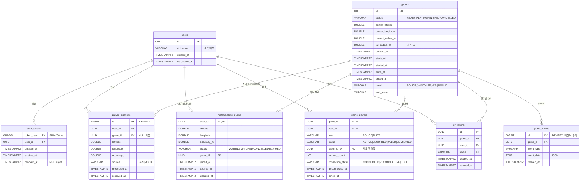

# DATABASE — 데이터베이스 설계

- DBMS: PostgreSQL (16/17 권장). 테스트는 H2(PostgreSQL 호환 모드)와 임베디드 PostgreSQL 14 에서 동일 스키마를 검증했다.
- 스키마 기준: `server/src/main/resources/db/migration/V1__initial_schema.sql` (Flyway 가 서버 시작 시 자동 적용).
- Kotlin 매핑: `server/.../database/Tables.kt` (Exposed DSL). `SchemaUtils.create` 는 쓰지 않는다.
- 모든 시각 컬럼은 `TIMESTAMP WITH TIME ZONE`(UTC 저장), API 에서는 epoch milliseconds.
- enum 값은 `VARCHAR` + `CHECK` 제약으로 저장한다(예: `status IN ('READY','PLAYING','FINISHED','CANCELLED')`).

## 1. ERD

## 2. 테이블 정의

| 테이블 | 용도 | 기본키 | 외래키 | 사용 상태 |
|---|---|---|---|---|
| `users` | 게스트 계정 (요구 모델 User) | `id` | — | 사용 중 |
| `auth_tokens` | 서버 발급 인증 토큰(해시) | `token_hash` | `user_id → users` (CASCADE) | 사용 중 |
| `player_locations` | 위치 기록 (PlayerLocation) | `id` | `user_id → users` (CASCADE), `game_id → games` (SET NULL) | 사용 중 |
| `matchmaking_queue` | 매칭 대기열 (MatchmakingQueue) | `user_id` | `user_id → users`, `game_id → games` | 스키마만 |
| `games` | 경기 (Game) | `id` | — | 스키마만 |
| `game_players` | 경기 참가자 (GamePlayer) | `(game_id, user_id)` | `game_id → games` (CASCADE), `user_id → users`, `captured_by → users` | 스키마만 |
| `game_events` | 경기 이벤트 로그 (GameEvent) | `id` | `game_id → games` (CASCADE) | 스키마만 |
| `qr_tokens` | 경기별 고정 QR (QRToken) | `id` | `game_id → games` (CASCADE), `user_id → users` | 스키마만 |

요청서 모델과의 대응: `PlayerLocation.timestamp` → `measured_at`(측정 시각) + `received_at`(서버 수신 시각), `MatchmakingQueue.location` → `latitude/longitude/accuracy_m`, `QRToken.playerId` → `user_id`, `QRToken.expiresAt` → `revoked_at`(경기 종료 시 설정, 아래 정책 참고).

## 3. 인덱스

| 인덱스 | 목적 |
|---|---|
| `idx_auth_tokens_user (user_id)` | 사용자별 토큰 폐기(로그아웃 구현 시) |
| `idx_player_locations_user_received (user_id, received_at)` | 내 최신 위치, 과속 판정용 직전 위치 조회 |
| `idx_player_locations_game_received (game_id, received_at)` | 경기별 공개 위치 조회 |
| `idx_matchmaking_status_joined (status, joined_at)` | WAITING 대기자 오래된 순 조회 |
| `idx_games_status (status)` | 진행 중 경기 스캔(타이머·종료 처리) |
| `idx_game_players_user (user_id)` | "내 현재 경기" 조회 |
| `idx_game_events_game_id (game_id, id)` | 재접속 시 `after=<id>` 이후 이벤트 재조회 |
| `uq_qr_tokens_token`, `uq_qr_tokens_game_user` | 토큰 전역 유일, 경기당 1인 1토큰 |

> 반경 500m 후보 검색은 초기에는 대기자 수가 적어 `WAITING` 전체를 읽고 서버에서 `GeoMath.distanceMeters` 로 거른다. 규모가 커지면 PostGIS(`geography` + GiST 인덱스) 도입을 검토한다.

## 4. 데이터 저장 정책

- **토큰**: 원문 저장 금지. SHA-256 해시만 저장하고 원문은 발급 응답에서 한 번만 내려준다. 기본 유효기간 30일(`PNT_TOKEN_TTL_DAYS`). 로그아웃 시 `revoked_at` 설정은 TODO(현재 기기에서만 삭제).
- **닉네임**: 인증 수단이 아니다. 중복 허용, 2~12자, 한글·영문·숫자·`_`.
- **위치**: `source = MOCK`(개발자 테스트 좌표)은 서버 설정 `PNT_ALLOW_MOCK_LOCATIONS=true` 일 때만 저장되고, 실제 GPS 와 구분된다. 보존 기간 정책(예: 경기 종료 7일 후 삭제)은 TODO — 개인정보이므로 팀에서 결정 후 배치 작업으로 구현.
- **위치 공개**: 매칭 전 타인 좌표는 어떤 API 로도 내려주지 않는다(대기 인원 수만). 경기 중에는 역할별 필터, 경기 종료 후에는 타인 좌표 조회 거부(NFR-S01/S02).
- **QR 토큰**: 경기 시작 전 참가자별 1개 발급(SecureRandom 32바이트). 경기 동안 고정, 체포 후에도 구출용으로 유지, 경기 종료 시 `revoked_at` 설정. 검증 시 `token` 으로 행을 찾은 뒤 **요청 경로의 gameId 와 행의 game_id 일치**, `revoked_at IS NULL`, 대상 사용자가 그 경기 참가자인지, 스캔한 사람의 역할·상태를 모두 서버에서 확인한다 → 다른 경기 재사용·위조 불가. QR 화면에서 다시 보여 줘야 하므로 토큰은 원문으로 저장한다(경기 한정·추측 불가 값).
- **이벤트**: `game_events.id` 가 전체 순서를 보장한다. 클라이언트는 마지막으로 받은 id 를 기억했다가 재접속 시 `GET /api/games/{id}/events?after=` 로 누락분을 받는다.
- **마이그레이션 규칙**: 적용된 `V1__...sql` 은 수정하지 않는다. 변경은 `V2__설명.sql` 처럼 새 파일로 추가한다.
