# DATABASE — 데이터베이스 설계

- DBMS: PostgreSQL (16/17 권장). 서버 테스트는 H2(PostgreSQL 호환 모드)와 임베디드 PostgreSQL 에서 같은 스키마로 실행된다(`PostgresIntegrationTest` 포함).
- 스키마 기준(Flyway 마이그레이션, 서버 시작 시 자동 적용):
  - `server/src/main/resources/db/migration/V1__initial_schema.sql` — 사용자·토큰·위치·경기 기본 틀
  - `server/src/main/resources/db/migration/V2__game_progress.sql` — 경기 진행(호송·구역·미션·결과·중복 요청 방지)
- Kotlin 매핑: `server/src/main/kotlin/com/nettwork/policethief/server/database/Tables.kt` (Exposed DSL). 테이블 생성은 Exposed 의 `SchemaUtils.create` 가 아니라 **Flyway SQL 로만** 한다.
- 연결·마이그레이션 코드: `database/AppDatabase.kt` (HikariCP 풀, `isAutoCommit=false`, 격리 수준 `READ_COMMITTED`).
- 모든 시각 컬럼은 `TIMESTAMP WITH TIME ZONE`(UTC), API 에서는 epoch milliseconds.
- enum 값은 `VARCHAR` + `CHECK` 제약으로 저장한다(예: `status IN ('READY','PLAYING','FINISHED','CANCELLED')`).
- 이 문서는 SQL 과 코드를 읽고 정리했다. 실제 PostgreSQL 서버(로컬 설치)에서 팀원이 직접 띄워 본 결과는 포함하지 않는다.

> 용어: **PK**(기본키: 행을 유일하게 식별), **FK**(외래키: 다른 테이블 행을 가리킴), **UNIQUE**(같은 값 두 번 저장 금지), **트랜잭션**(여러 쓰기를 "전부 성공 또는 전부 취소"로 묶는 단위), **Flyway**(`V숫자__이름.sql` 파일을 순서대로 한 번씩만 실행해 주는 DB 버전 관리 도구).

## 1. ERD (V1 + V2 전체)

```mermaid
erDiagram
    users ||--o{ auth_tokens : "발급"
    users ||--o{ player_locations : "보고"
    users ||--o| matchmaking_queue : "대기(최대 1행)"
    users ||--o{ game_players : "참가"
    users ||--o| active_participations : "진행 중 경기(최대 1개)"
    users ||--o{ qr_tokens : "소유(도둑)"
    users ||--o{ scan_requests : "스캔 요청"
    games ||--|{ game_players : "참가자 4명"
    games ||--o{ active_participations : "진행 중 참가 기록"
    games ||--o{ game_events : "이벤트"
    games ||--o{ qr_tokens : "경기별 QR"
    games ||--o{ player_locations : "경기 중 위치(선택)"
    games ||--o{ matchmaking_queue : "매칭 결과 gameId"
    games ||--o{ escorts : "호송 기록"
    games ||--o{ game_zone_stages : "구역 축소 일정"
    games ||--o{ missions : "도둑 미션"
    games ||--o| game_results : "결과(1회)"
    games ||--o{ scan_requests : "스캔 요청 기록"
    game_players ||--o| game_players : "escorting_user_id / captured_by 로 서로 참조"

    users {
        UUID id PK
        VARCHAR nickname "중복 허용"
        TIMESTAMPTZ created_at
        TIMESTAMPTZ last_active_at
    }
    auth_tokens {
        CHAR64 token_hash PK "SHA-256 hex"
        UUID user_id FK
        TIMESTAMPTZ created_at
        TIMESTAMPTZ expires_at
        TIMESTAMPTZ revoked_at "NULL=유효"
    }
    player_locations {
        BIGINT id PK "IDENTITY"
        UUID user_id FK
        UUID game_id FK "NULL 허용, 경기 삭제 시 NULL"
        DOUBLE latitude
        DOUBLE longitude
        DOUBLE accuracy_m
        VARCHAR source "GPS|MOCK"
        TIMESTAMPTZ measured_at "단말 측정 시각"
        TIMESTAMPTZ received_at "서버 수신 시각"
    }
    matchmaking_queue {
        UUID user_id PK,FK "사용자당 1행"
        DOUBLE latitude
        DOUBLE longitude
        DOUBLE accuracy_m
        VARCHAR source "GPS|MOCK (V2)"
        VARCHAR status "WAITING|MATCHED|CANCELLED|EXPIRED"
        UUID game_id FK
        TIMESTAMPTZ joined_at
        TIMESTAMPTZ expires_at "joined_at + 10분"
        TIMESTAMPTZ updated_at "마지막 위치 갱신"
    }
    games {
        UUID id PK
        VARCHAR status "READY|PLAYING|FINISHED|CANCELLED"
        BIGINT version "V2, 변경마다 +1"
        DOUBLE center_latitude
        DOUBLE center_longitude
        DOUBLE initial_radius_m "V2, 500"
        DOUBLE current_radius_m
        DOUBLE jail_radius_m "10"
        TIMESTAMPTZ created_at
        TIMESTAMPTZ starts_at "준비 종료=시작 예정"
        TIMESTAMPTZ started_at
        TIMESTAMPTZ ends_at "starts_at + 30분"
        TIMESTAMPTZ ended_at
        VARCHAR result "POLICE_WIN|THIEF_WIN|INVALID"
        VARCHAR end_reason
        TIMESTAMPTZ next_mission_at "V2"
    }
    game_players {
        UUID game_id PK,FK
        UUID user_id PK,FK
        VARCHAR role "POLICE|THIEF"
        VARCHAR status "ACTIVE|ESCORTED|JAILED|ELIMINATED"
        UUID captured_by FK "체포한 경찰"
        UUID escorting_user_id FK "V2, 호송 중인 도둑"
        INT warning_count
        VARCHAR connection_state "CONNECTED|RECONNECTING|LEFT"
        TIMESTAMPTZ disconnected_at
        TIMESTAMPTZ out_of_zone_since "V2"
        INT speed_candidate_count "V2"
        TIMESTAMPTZ last_speed_warning_at "V2"
        TIMESTAMPTZ last_ring_at "V2"
        TIMESTAMPTZ joined_at
    }
    active_participations {
        UUID user_id PK,FK "한 명당 1경기"
        UUID game_id FK
        TIMESTAMPTZ joined_at
    }
    escorts {
        BIGINT id PK
        UUID game_id FK
        UUID police_id FK
        UUID thief_id FK
        TIMESTAMPTZ started_at
        TIMESTAMPTZ ended_at "NULL=호송 중"
        VARCHAR end_reason "JAILED|GAME_ENDED"
    }
    game_zone_stages {
        UUID game_id PK,FK
        INT stage_no PK
        TIMESTAMPTZ scheduled_at
        DOUBLE radius_m
        TIMESTAMPTZ warned_at
        TIMESTAMPTZ applied_at
    }
    missions {
        UUID id PK
        UUID game_id FK
        DOUBLE target_latitude
        DOUBLE target_longitude
        DOUBLE target_radius_m
        TIMESTAMPTZ started_at
        TIMESTAMPTZ deadline_at
        VARCHAR status "ACTIVE|COMPLETED|FAILED|CANCELLED"
        UUID completed_by FK
        TIMESTAMPTZ ended_at
    }
    game_events {
        BIGINT id PK "IDENTITY, 이벤트 순서"
        UUID game_id FK
        VARCHAR event_type
        TEXT event_data "JSON"
        BIGINT game_version "V2"
        VARCHAR visibility "ALL|POLICE|THIEF|USER (V2)"
        UUID target_user_id "visibility=USER 일 때 수신자"
        TIMESTAMPTZ created_at
    }
    qr_tokens {
        UUID id PK
        UUID game_id FK
        UUID user_id FK
        VARCHAR token UK
        TIMESTAMPTZ created_at
        TIMESTAMPTZ revoked_at
    }
    game_results {
        UUID game_id PK,FK "경기당 결과 1건"
        VARCHAR result
        VARCHAR end_reason
        TIMESTAMPTZ decided_at
        BIGINT decided_version
    }
    scan_requests {
        UUID user_id PK,FK
        VARCHAR request_id PK "앱이 만든 ID(64자 이하)"
        UUID game_id FK
        VARCHAR kind "CAPTURE|RESCUE"
        TEXT result_json "처음 판정 결과"
        TIMESTAMPTZ created_at
    }
```

## 2. 테이블 정의

| 테이블 | 용도 | 기본키 | 외래키(삭제 동작) | 도입 |
|---|---|---|---|---|
| `users` | 게스트 계정 | `id` | — | V1 |
| `auth_tokens` | 서버 발급 토큰(해시) | `token_hash` | `user_id → users` (CASCADE) | V1 |
| `player_locations` | 위치 기록(GPS/MOCK) | `id` | `user_id → users` (CASCADE), `game_id → games` (SET NULL) | V1 |
| `matchmaking_queue` | 매칭 대기열 | `user_id` | `user_id → users` (CASCADE), `game_id → games` | V1 (+`source` V2) |
| `games` | 경기 | `id` | — | V1 (+`version`, `initial_radius_m`, `next_mission_at` V2) |
| `game_players` | 경기 참가자 | `(game_id, user_id)` | `game_id → games` (CASCADE), `user_id`/`captured_by`/`escorting_user_id → users` | V1 (+V2 컬럼 5개) |
| `game_events` | 이벤트 로그 | `id` | `game_id → games` (CASCADE) | V1 (+`game_version`, `visibility`, `target_user_id` V2) |
| `qr_tokens` | 도둑의 경기별 고정 QR | `id` | `game_id → games` (CASCADE), `user_id → users` | V1 |
| `active_participations` | "지금 진행 중인 경기" 참가 기록 | `user_id` | `user_id → users`, `game_id → games` (CASCADE) | V2 |
| `escorts` | 호송(체포→수감) 이력 | `id` | `game_id → games` (CASCADE), `police_id`/`thief_id → users` | V2 |
| `game_zone_stages` | 구역 축소 일정 | `(game_id, stage_no)` | `game_id → games` (CASCADE) | V2 |
| `missions` | 도둑 미션 | `id` | `game_id → games` (CASCADE), `completed_by → users` | V2 |
| `game_results` | 경기 결과(1회만) | `game_id` | `game_id → games` (CASCADE) | V2 |
| `scan_requests` | QR 스캔 요청 기록(중복 방지) | `(user_id, request_id)` | `user_id → users`, `game_id → games` (CASCADE) | V2 |

`game_players.captured_by` 는 "이 도둑을 체포한 경찰"로, 수감된 뒤에도 남고 구출되면 `NULL` 이 된다. `game_players.escorting_user_id` 는 "이 경찰이 지금 호송 중인 도둑"이다.

## 3. 중복을 막는 제약 (UNIQUE / PK) 정리

"같은 일이 두 번 일어나면 안 되는 것"을 **DB 가 마지막으로 막는** 장치다. 일반적으로는 서버의 `GameLock` + 상태 검사(예: 도둑이 `ACTIVE` 일 때만 체포 가능)가 먼저 막고, DB 제약은 그 방어선이 뚫려도 데이터가 깨지지 않게 하는 안전망이다.

| 막으려는 중복 | 제약 | 위치 |
|---|---|---|
| 한 사용자가 **동시에 두 경기**에 참가 | `active_participations` 의 PK `user_id` (경기 종료 때 행 삭제) | V2 |
| 한 경기에 **같은 사용자가 두 번** 참가 | `game_players` PK `(game_id, user_id)` | V1 |
| 한 사용자가 대기열에 **두 번** 등록 | `matchmaking_queue` PK `user_id` | V1 |
| **같은 도둑을 두 경찰이** 동시에 호송 / **경찰 1명이 2명** 호송 | `uq_players_escorting` UNIQUE `(game_id, escorting_user_id)` + 경찰 한 행에 `escorting_user_id` 컬럼이 **하나뿐** | V2 |
| 경기 **결과 두 번** 확정 | `game_results` PK `game_id` (+ 코드의 `finish()` 가 이미 끝난 경기는 무시) | V2 |
| **같은 스캔 재전송**으로 체포/구출이 두 번 처리 | `scan_requests` PK `(user_id, request_id)` | V2 |
| 도둑 QR 이 **중복 발급** / 토큰 값 충돌 | `uq_qr_tokens_game_user` UNIQUE `(game_id, user_id)`, `uq_qr_tokens_token` UNIQUE `token` | V1 |
| 같은 단계의 구역 축소 일정 중복 | `game_zone_stages` PK `(game_id, stage_no)` | V2 |
| 잘못된 enum 값 | `chk_*` CHECK 제약(경기·플레이어 상태, 결과, 가시성, 스캔 종류 등) | V1/V2 |

**DB 제약이 없는 부분(코드로만 막는 것)**: 같은 도둑의 "체포"·"수감"·"구출" 이력 자체(`escorts`, `game_events`)에는 UNIQUE 가 없다. 이 중복은 서버가 한 번에 한 요청만 처리(`GameLock`)하고 도둑의 상태(`ACTIVE`→`ESCORTED`→`JAILED`→`ACTIVE`)를 검사해서 막는다. 구출은 별도 테이블 없이 `game_events` 의 `THIEF_RESCUED` 로 남는다. `escorts` 에서 "진행 중 호송은 도둑당 1개"라는 UNIQUE(부분 인덱스)는 걸려 있지 않다.

## 4. 같은 트랜잭션으로 묶이는 작업

`GameEngine.mutate` / `MatchmakingService.locked` 는 항상 **① `GameLock` 획득 → ② DB 트랜잭션 시작 → ③ 처리 → ④ 커밋 → ⑤ 커밋 후 WebSocket 전송** 순서다(`game/GameEngine.kt`, `matchmaking/MatchmakingService.kt`, `common/GameLock.kt`). 중간에 예외가 나면 DB 는 롤백되고 알림은 보내지지 않는다(`notification/Outbox`).

| 작업 | 한 트랜잭션에 들어가는 쓰기 |
|---|---|
| **매칭 확정**(`MatchmakingService.matchAndNotify` → `GameStore.createGame`) | 대기열 행 `FOR UPDATE` 잠금 재확인 → `games` 1행, `game_players` 4행(무작위 2:2), `active_participations` 4행, 도둑 `qr_tokens` 2행, 각자의 최초 `player_locations`, `game_zone_stages`, `GAME_PREPARING` `game_events` → `matchmaking_queue` 를 `MATCHED` 로 |
| **체포/구출 요청**(`GameEngine.scan`) | 지난 예정 판정 적용 → `game_players` 상태 변경 → `escorts` 추가 → `game_events` 추가 → 경기가 끝났다면 종료 처리 → `scan_requests` 저장 (전부 한 번에) |
| **위치 수신**(`GameEngine.ingest`) | `player_locations` 저장 + 과속·구역·감옥·미션 판정 결과(`game_players`, `escorts`, `missions`, `game_events`, `games.version`) |
| **경기 종료**(`GameStore.save` → `onGameEnded`, 어떤 요청에서든 종료가 확정되면) | `games` 결과 컬럼, `qr_tokens.revoked_at` 설정, `active_participations` 삭제, 열린 `escorts` 종료(`GAME_ENDED`), `game_results` INSERT, `GAME_FINISHED`/`GAME_INVALIDATED` 이벤트 |
| **스케줄러 tick**(매 1초) | 매칭 만료 처리·재시도 + 진행 중인 모든 경기의 예정 판정(시작·종료·구역 축소·미션·재접속 유예) — 모두 한 트랜잭션 |

경기 상태가 바뀌면(`GameStore.save`) `games.version` 이 1 올라가고, 그때 만들어진 이벤트는 같은 `game_version` 으로 기록된다.

종료 시 `game_results` INSERT 는 "불러올 때는 끝나지 않았다가 이번 처리에서 끝난 경기"(`wasEndedAtLoad=false`)에서만 실행되므로 결과는 한 번만 저장된다.

## 5. 서버 재시작 복구

- 경기 상태는 전부 DB 에 있다(메모리 상태에 의존하지 않음).
- 서버가 시작되면 스케줄러가 먼저 `GameEngine.recoverAfterRestart()` 를 **한 번** 실행한다(`Application.kt` 의 `startGameScheduler`):
  1. 진행 중(`READY`/`PLAYING`) 경기를 모두 읽는다.
  2. 꺼져 있던 동안 지난 예정 판정을 시간 순서대로 모두 적용한다(`advanceTo`). 예: 서버가 꺼진 사이 30분이 지났다면 도둑 승리로 종료.
  3. 아직 WebSocket 으로 다시 접속하지 않은 `CONNECTED` 참가자는 "지금 끊김"으로 보고 **3분 재접속 유예**를 새로 시작한다.
- 이후 약 1초마다 `tick()` 을 돌린다. tick 이 실패해도(예: DB 일시 중단) 다음 tick 에서 이어서 처리한다.
- 개발자 도구의 봇 목록(메모리)은 재시작하면 사라진다.
- 테스트: `ConnectionAndRecoveryTest` 의 `serverRestart_recoversGame_andAppliesMissedDeadlines`, `serverRestart_startsGraceForPlayersNotYetReconnected`.

## 6. 위치 기록 보관(삭제) 정책

- `GameEngine.tick()` 이 **10분마다** `GameStore.deleteLocationsBefore(now - 보관기간)` 을 실행해 `player_locations.received_at` 이 보관 기간보다 오래된 행을 삭제한다.
- 보관 기간은 `PNT_LOCATION_RETENTION_HOURS`(기본 **24시간**, 정수 시간 단위) — `docs/development/GAME_CONFIG.md`.
- 삭제 조건은 `received_at` 하나뿐이다. `game_id` 가 있는 경기 위치 기록도 같이 삭제된다(코드 `GameStore.deleteLocationsBefore`). 진행 중 경기(최대 약 31분)는 기본 보관 기간보다 짧아 영향이 없다.
- 위치는 개인정보이므로 보관 기간을 줄이는 것을 권장한다. 이 서버는 실제 사용자 데이터를 장기 보관하도록 만들어지지 않았다.

## 7. 인덱스

| 인덱스 | 목적 |
|---|---|
| `idx_auth_tokens_user (user_id)` | 사용자별 토큰 조회 |
| `idx_player_locations_user_received (user_id, received_at)` | 내 최신 위치, 보관 기간 삭제 |
| `idx_player_locations_game_received (game_id, received_at)` | 경기별 위치 조회 |
| `idx_player_locations_game_user_measured (game_id, user_id, measured_at)` (V2) | 경기에서 사용자별 "측정 시각이 가장 늦은" 위치 조회 |
| `idx_matchmaking_status_joined (status, joined_at)` | WAITING 대기자 오래된 순 조회 |
| `idx_games_status (status)` | 진행 중 경기 스캔(스케줄러) |
| `idx_game_players_user (user_id)` | 사용자별 참가 경기 조회 |
| `idx_game_events_game_id (game_id, id)` | 재접속 시 `after=<id>` 이후 이벤트 조회 |
| `idx_active_participations_game (game_id)` (V2) | 경기 종료 시 참가 기록 삭제 |
| `idx_escorts_game (game_id)`, `idx_missions_game (game_id)` (V2) | 경기별 조회 |

> 반경 500m 후보 검색은 대기자 수가 적으므로 `WAITING` 전체를 읽고 서버에서 Haversine(`GeoMath.distanceMeters`)으로 거른다. 규모가 커지면 PostGIS 도입을 검토한다.

## 8. 데이터 저장 정책

- **토큰**: 원문 저장 금지. SHA-256 해시만 저장하고 원문은 발급 응답에서 한 번만 내려준다. 기본 유효기간 30일(`PNT_TOKEN_TTL_DAYS`). 현재 서버에는 로그아웃(토큰 폐기) API 가 없다(`revoked_at` 컬럼만 존재).
- **닉네임**: 인증 수단이 아니다. 중복 허용, 2~12자, 한글·영문·숫자·`_`.
- **위치**: `source = MOCK` 은 `PNT_ALLOW_MOCK_LOCATIONS=true` 일 때만 저장된다. 매칭에 쓴 위치는 확정 시 그 경기의 **최초 위치**로 `player_locations` 에 다시 한 번 복사된다.
- **위치 공개**: 매칭 전 타인 좌표는 어떤 API 로도 내려주지 않는다(대기 인원 수만). 경기 중에는 역할별 필터, 경기 종료 후에는 타인 좌표 조회 거부.
- **QR 토큰**: 도둑 2명에게만 경기 생성 시 1개씩 발급(`SecureRandom` 24바이트 → URL-safe Base64 32자, 앞에 `PNT1.` 접두어, 총 37자 / 컬럼 `VARCHAR(64)`). 경기 동안 고정, 체포 후에도 구출용으로 유지, 경기 종료 시 `revoked_at` 설정. 검증은 `token` 으로 행을 찾은 뒤 "요청 경로의 gameId 와 행의 game_id 일치", `revoked_at IS NULL`, 스캔한 사람의 역할·상태를 모두 서버가 확인한다 → 다른 경기 재사용·위조 불가. QR 화면에 다시 보여 줘야 하므로 토큰 원문을 저장한다(경기 한정·추측 불가 값).
- **이벤트**: `game_events.id` 가 전체 순서를 보장한다. `visibility`/`target_user_id` 로 누가 볼 수 있는지 정해지고(`ALL`/`POLICE`/`THIEF`/`USER`), 조회할 때 DB 에서 걸러진다. 일시 이벤트(`JAIL_CHECK_PENDING`)는 저장하지 않는다.
- **마이그레이션 규칙**: 적용된 `V1__...sql`, `V2__...sql` 은 **수정하지 않는다**(Flyway 체크섬 오류). 변경은 `V3__설명.sql` 처럼 새 파일로 추가한다.
