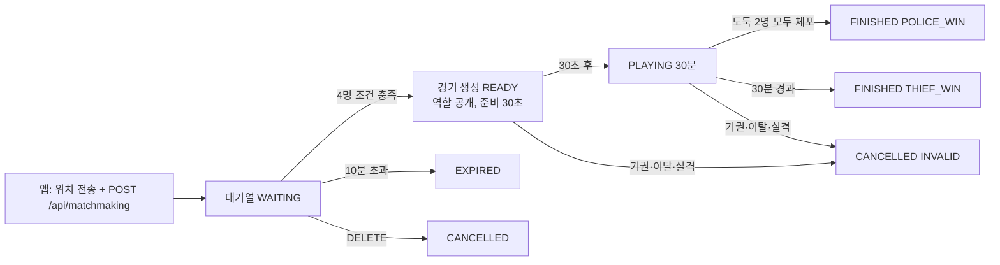
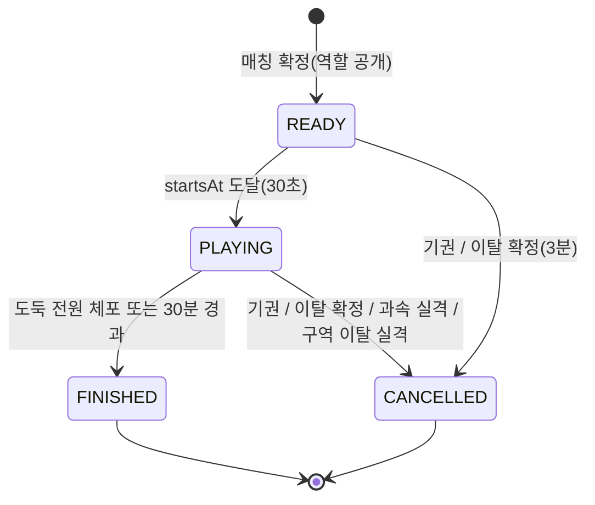
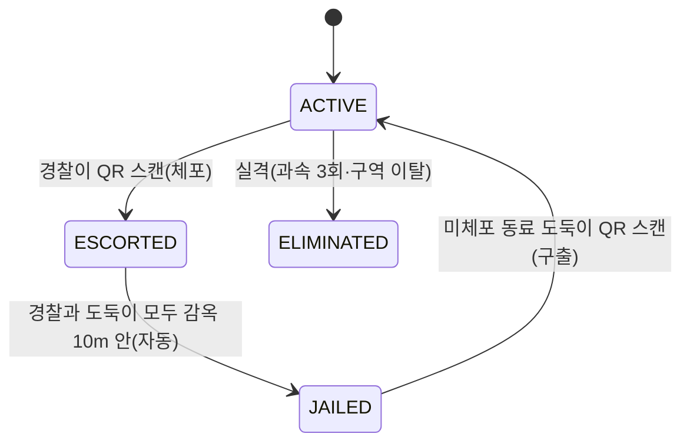

# GAME_LOGIC — 서버 게임 로직 설명서

이 문서는 **이미 구현된 서버**가 실제로 어떻게 판정하는지를 코드(`server/src/main/kotlin/com/nettwork/policethief/server/`)에서 읽어 정리한 것이다. 코드와 다르면 코드가 기준이다.
숫자 중 **확정(CONFIRMED)** 은 `shared/.../rules/GameRules.kt` 의 상수이고, **임시(PROVISIONAL)** 는 `game/GameSettings.kt` 의 값(환경 변수로 바꿀 수 있음)이다. 값 목록은 [`GAME_CONFIG.md`](GAME_CONFIG.md), API 는 [`API.md`](../api/API.md).

> 검증 범위: 서버 단위·통합 테스트(75개 통과). 실제 휴대폰 GPS, iOS, 실외 이동으로 검증한 것이 아니다(NOT VERIFIED).

## 0. 용어

| 용어 | 뜻 |
|---|---|
| 서버 판정 | 체포·감옥·승패 등 모든 규칙 판정은 서버가 한다. 앱은 결과를 표시만 한다 |
| 호송(Escort) | 경찰이 체포한 도둑을 감옥까지 데려가는 중인 상태 |
| 감옥 | 게임 구역의 **중심점**. 반경 10m(확정) |
| Haversine | 위도·경도 두 점 사이의 실제 지표면 거리(m)를 구하는 공식(`shared/.../geo/GeoMath.kt`) |
| 중심점(centroid) | 4명 위도 평균, 4명 경도 평균으로 만든 점 |
| 트랜잭션 | 여러 DB 쓰기를 "전부 성공 또는 전부 취소"로 묶는 단위 |

## 1. 경기 흐름 한눈에

## 2. 매칭

코드: `matchmaking/MatchFinder.kt`(순수 알고리즘), `matchmaking/MatchmakingService.kt`(대기열·잠금·알림).

### 2-1. 대기열에 들어가기 (`POST /api/matchmaking`)

1. 위치 검증: 일반 위치 검증(§8) + **정확도 ≤ 100m**(`PNT_GAME_MATCH_MAX_ACCURACY_M`) + **측정 후 60초 이내**(`PNT_GAME_MATCH_LOCATION_MAX_AGE_SECONDS`). 아니면 422.
2. 이미 READY/PLAYING 경기에 참가 중이면 409 `ALREADY_IN_GAME`.
3. 이미 대기 중이면 위치만 갱신(대기 시작·만료 시각 유지). 아니면 새 행을 만들고 **만료 = 지금 + 10분**(확정, `MATCH_TIMEOUT_MILLIS`).
4. 곧바로 매칭을 시도한다.

대기 중에 앱은 계속 `POST /api/locations` 로 위치를 보내야 한다. 대기열의 마지막 위치 갱신(`updated_at`)이 **60초보다 오래된 사람은 후보에서 빠진다**(앱이 꺼졌거나 연결이 끊긴 사람을 매칭하지 않기 위해). 빠져도 대기 상태는 유지되고, 위치를 다시 보내면 후보로 돌아온다. 대기열 위치 갱신은 정확도가 100m 이하일 때만 반영된다.

### 2-2. 4명 조합 찾기 (`MatchFinder`)

조건(확정 규칙 `GameRules`):
- **쌍(pairwise) 조건**: 4명 **모두 서로** 500m 이내(Haversine 실제 거리, 위경도 차이가 아님).
- **중심점 조건**: 4명의 중심점에서 반경 500m(초기 구역 반경) 안에 4명 모두 포함. 쌍 조건을 만족하면 수학적으로 이것도 만족하지만, 구역 생성 실패를 막으려고 한 번 더 확인한다(`isValidGroup`).

알고리즘:
1. 대기자를 **오래 기다린 순**(`joinedAt`, 같으면 `userId`)으로 정렬한다. 중복 사용자는 제거.
2. 가장 오래 기다린 사람부터 **기준(anchor)** 으로 삼는다. 기준에서 500m 이내인 사람을 오래 기다린 순으로 최대 24명(`MAX_CANDIDATES_PER_ANCHOR`)까지 후보로 모은다. 후보가 3명 미만이면 다음 기준으로.
3. 후보 중 3명을 **깊이 우선 탐색**으로 고른다. 새로 넣을 사람이 이미 고른 사람 모두와 500m 이내인 경우만 이어 간다(오래 기다린 사람 우선).
4. 4명이 모이면 `isValidGroup`(쌍 + 중심점)으로 확인하고 통과하면 그 조합을 확정, 아니면 **다른 조합** → **다른 기준** 순으로 계속 탐색한다.
5. 한 조를 만들면 그 4명을 빼고 남은 사람으로 같은 방식을 반복(조가 여러 개 생길 수 있음).

공정성: 기다린 시간이 긴 사람이 항상 먼저 기준이 된다. 서버 스케줄러가 약 1초마다 매칭을 다시 시도하고(`GameEngine.tick` → `tickLocked`), 위치가 갱신될 때나 누군가 취소할 때도 다시 시도한다.

### 2-3. 확정 시 잠금 (동시성)

`matchAndNotify` 는 `GameLock` 안에서 DB 트랜잭션을 열고, 후보 4명의 대기열 행을 `SELECT ... FOR UPDATE` 로 잠근 뒤 **아직 4명 모두 `WAITING` 이고 진행 중 경기가 없는지** 다시 확인한다. 하나라도 어긋나면 이 조는 만들지 않는다. 그래서 확정 직전에 취소한 사람이나 다른 경기에 먼저 들어간 사람이 섞이지 않는다. 테스트: `concurrentJoins_putEveryUserInExactlyOneGame`.

### 2-4. 경기 생성 (`GameStore.createGame`, 한 트랜잭션)

- 구역 중심 = 4명의 중심점, 초기 반경 500m, 감옥 반경 10m(구역 중심이 감옥).
- `startsAt` = 확정 시각 + 30초(확정 `PREPARATION_MILLIS`), `endsAt` = `startsAt` + 30분(확정 `GAME_DURATION_MILLIS`).
- **역할 배정**: 4명을 `SecureRandom` 으로 시드한 난수로 섞어 앞 2명 `POLICE`, 뒤 2명 `THIEF`. 경기 생성 시 **단 한 번**만 정한다.
- 도둑 2명에게만 QR 토큰 발급. 경기·참가자·`active_participations`·구역 축소 일정(`game_zone_stages`, 경기 시작 기준 오프셋, 30분 미만인 단계만)·각자의 최초 위치·`GAME_PREPARING` 이벤트를 만든다.

### 2-5. 취소 vs 기권 (cancel vs forfeit)

| 상황 | 동작 |
|---|---|
| 대기 중 `DELETE /api/matchmaking/me` | 대기열 `CANCELLED`. 확정 직전 경합이 있어도 서버 기준으로 확정(이미 취소됐으면 매칭에서 제외). 여러 번 보내도 204 |
| 이미 매칭 확정(`MATCHED`, 경기 진행 중) 후 `DELETE` | **409 `ALREADY_MATCHED`**. 대기 취소가 아니라 `forfeit` 사용 |
| `POST /api/games/{id}/forfeit` | 경기 **전체가 무효**(`CANCELLED` / `INVALID` / `PLAYER_FORFEITED`) |

## 3. 경기 상태 머신

경기 상태(`GameStatus`)는 플레이어 개인 상태와 별개다. 코드의 `READY` = 요구서의 `PREPARING`, `CANCELLED` = `INVALID`.

- `READY` 동안은 위치만 받는다. 체포·구출은 `GAME_NOT_PLAYING` 으로 거절. 구역·과속·감옥 판정도 `PLAYING` 일 때만 한다.
- 시작 시각은 서버가 정한 `startsAt` 그대로 기록된다(`startedAt = startsAt`).
- 종료(`GameSession.finish`)는 **한 번만** 일어난다. 이미 끝난 경기는 무시. 종료 시 진행 중 호송과 미션(`ACTIVE`)이 끝나고(`escortingUserId` 비움, 미션 `CANCELLED`), QR 폐기·참가 기록 삭제·결과 저장이 같은 트랜잭션에서 일어난다(DATABASE.md §4).
- 같은 상황의 결과: **정상 승패는 `FINISHED`**, 그 외(기권·실격·이탈)는 `CANCELLED` + `result=INVALID`.

### 도둑 상태 (`PlayerStatus`)

- 경찰은 항상 `ACTIVE`(실격되면 `ELIMINATED`). 경찰은 `escortingUserId` 로 "지금 호송 중인 도둑 1명"을 가진다. **경찰 1명은 동시에 1명만** 호송한다(`MAX_ESCORTS_PER_POLICE=1`).
- 도둑의 `capturedBy` = 체포한 경찰(수감 후에도 유지, 구출되면 `null`).
- 실격(`ELIMINATED`)이 나오면 경기는 즉시 무효가 되므로 실제로는 "실격자가 있는 경기가 계속 진행"되는 경우가 없다.

## 4. 체포(Capture)와 구출(Rescue)

### 4-1. 체포 검증 순서 (`rules/CaptureRules.kt`)

위에서부터 **첫 번째로 걸린 사유**가 `rejectReason` 이 된다(HTTP 는 200, `accepted:false`).

| 순서 | 검사 | 거절 사유 |
|---|---|---|
| 0 | `requestId` 형식(1~64자) / 이미 처리한 `requestId` | 422 / 처음 결과 그대로 반환 |
| 0-1 | 참가자인지 | 404 / 403 (HTTP 오류) |
| 0-2 | 지난 예정 판정 먼저 적용(§6) | — |
| 1 | 경기가 `PLAYING` 인가 | `GAME_NOT_PLAYING` |
| 2 | 요청자가 `ACTIVE` 상태의 **경찰**인가 | `NOT_ALLOWED` |
| 3 | 토큰이 DB 에 있는가 / 폐기됐나 | `INVALID_TOKEN` |
| 4 | 토큰이 이 경기의 것인가(소유자가 이 경기 참가자) | `OTHER_GAME` |
| 5 | 스캔 대상이 나 자신인가 | `SELF_SCAN` |
| 6 | 대상이 도둑인가(경찰 QR 은 없지만 방어) | `NOT_ALLOWED` |
| 7 | 대상이 `ACTIVE` 인가 | `ALREADY_CAPTURED` (이미 `ESCORTED`/`JAILED`/`ELIMINATED`) |
| 8 | 요청한 경찰이 이미 호송 중인가 | `ESCORT_LIMIT` |

성공하면: 도둑 `ESCORTED` + `capturedBy`, 경찰 `escortingUserId`, `escorts` 행 추가, `THIEF_ARRESTED` 이벤트. 이어서 **경찰 승리 검사**: 도둑 2명이 모두 `ESCORTED` 또는 `JAILED` 면 감옥 도착 여부와 상관없이 **즉시** `POLICE_WIN`(`ALL_THIEVES_CAPTURED`).

### 4-2. 구출 검증 순서 (`rules/RescueRules.kt`)

| 순서 | 검사 | 거절 사유 |
|---|---|---|
| 1 | 경기가 `PLAYING` | `GAME_NOT_PLAYING` |
| 2 | 요청자가 **도둑**인가 | `NOT_ALLOWED` (경찰은 구출 불가) |
| 3 | 요청자(구출자)가 `ACTIVE` 인가 | `RESCUER_NOT_ACTIVE` (체포된 도둑은 구출자가 될 수 없음) |
| 4~5 | 토큰 유효 / 이 경기 | `INVALID_TOKEN` / `OTHER_GAME` |
| 6 | 자기 자신 | `SELF_SCAN` |
| 7 | 대상이 도둑인가 | `NOT_ALLOWED` |
| 8 | 대상이 `JAILED` 인가 | 호송 중(`ESCORTED`)이면 `TARGET_ESCORTED`, 그 외 `TARGET_NOT_JAILED` |

성공하면 대상 도둑 `ACTIVE`, `capturedBy=null`, `THIEF_RESCUED` 이벤트. 도둑이 모두 체포되는 순간 경기가 끝나므로, 구출은 "한 도둑이 수감 중이고 다른 도둑이 미체포"일 때만 의미가 있다.

### 4-3. 중복 요청(requestId)

`(userId, requestId)` 가 이미 처리됐으면 판정하지 않고 저장된 첫 결과를 돌려준다(`GameEngine.scan`, DB `scan_requests`). 따라서 응답을 못 받고 재전송해도 이중 체포가 없다. 같은 도둑을 서로 다른 경찰이 동시에 스캔하면 먼저 처리된 한 건만 성공하고 나머지는 `ALREADY_CAPTURED`(테스트 `simultaneousCaptures_ofSameThief_onlyOneSucceeds`).

## 5. 자동 수감 (감옥 판정)

코드: `rules/JailRules.kt`. 감옥 = 구역 중심, 반경 **10m**(확정, 줄이거나 늘리지 않음).

- 판정 시점: **호송 중인 경찰 또는 호송 중인 도둑의 위치가 갱신될 때**(둘 중 누구든). 시간이 흘러서가 아니라 위치 수신 때만 판정한다.
- 대상 쌍: 경찰의 `escortingUserId` 도둑과 그 경찰. 도둑이 `ESCORTED` 이고 `capturedBy` 가 그 경찰일 때만.
- 결과 3가지(`JailVerdict`):

| 결과 | 조건 | 처리 |
|---|---|---|
| `CONFIRMED` | 두 사람의 **마지막 위치**가 모두 감옥 중심에서 **10m 이하**(경계 포함), 그리고 두 표본 모두 **정확도 ≤ 15m**(`PNT_GAME_JAIL_MAX_ACCURACY_M`), **측정 후 30초 이내**(`PNT_GAME_JAIL_SAMPLE_MAX_AGE_SECONDS`) | 도둑 `JAILED`, 경찰 호송 해제, `escorts` 종료(`JAILED`), `THIEF_JAILED` 이벤트 |
| `UNRELIABLE` | 두 사람 모두 10m 안으로 보이나 정확도·최신성이 부족 | 수감하지 않고 일시 이벤트 `JAIL_CHECK_PENDING` 을 경찰·도둑에게 각각 전달(GPS 다시 잡도록 안내) |
| `OUTSIDE` | 한 명이라도 10m 밖이거나 위치가 없음 | 아무 일 없음 |

`ESCORTED` 일 때만 확정되므로 같은 위치가 여러 번 와도 수감은 한 번만 일어난다. 테스트: `jail_boundaryAndAccuracy`, `jail_requiresFreshPoliceSample`.

## 6. 시간 판정과 경계 시각 정책 (중요)

코드: `rules/DeadlineRules.kt`, `game/GameEngine.kt`.

### 정책

> **서버는 어떤 요청이든(체포·구출·위치·기권·조회 포함) 처리하기 직전에, "지금까지 지난 예정 판정"을 시간 순서대로 모두 먼저 적용한다. 그다음에 요청을 처리한다.**

예정 판정(`Deadline`)의 종류와 같은 시각에서의 우선순위(`DeadlineKind.priority`, 작을수록 먼저):

| 우선순위 | 종류 | 의미 |
|---|---|---|
| 0 | `START` | 준비 종료 → `PLAYING` (`startsAt`) |
| 1 | `ZONE_WARNING` | 구역 축소 예고(축소 시각 − 60초) |
| 2 | `ZONE_SHRINK` | 구역 축소 적용 |
| 3 | `MISSION_DEADLINE` | 미션 마감(실패) |
| 4 | `MISSION_START` | 다음 미션 시작 |
| 5 | `TIME_OVER` | 30분 경과 → 도둑 승리(`endsAt`) |
| 6 | `DISCONNECT_TIMEOUT` | 재접속 유예(3분) 만료 → 무효 |
| 7 | `ZONE_OUT_TIMEOUT` | 구역 이탈 허용시간 만료 → 실격 → 무효 |

규칙:
1. 예정 시각이 `now` 이하(`!at.isAfter(now)`)인 것만 골라, **시각이 이른 순**, 같은 시각이면 위 우선순위 순으로 하나씩 적용하고 다시 목록을 만든다(하나 적용하면 새 예정이 생길 수 있음).
2. 경기가 끝나면 그 시점에서 멈춘다. 그 뒤의 예정 판정은 적용되지 않는다.
3. **경계 포함**: 예정 시각 = 요청 처리 시각이어도 예정 판정이 **먼저** 적용된다. 따라서 **제한 시간 `endsAt` 와 정확히 같은 시각에 도착한 체포는 `TIME_OVER`(도둑 승리)에 진다** → `GAME_NOT_PLAYING` 으로 거절. `endsAt` **직전**(1ms 전)에 도착해 마지막 도둑을 체포하면 경찰 승리(테스트 `captureJustBeforeTimeOver_winsForPolice`, `timeOver_thievesWin_andLateCaptureIsRejected`).
4. 같은 시각 충돌: 정상 승패(`TIME_OVER`, 5)가 같은 시각의 무효 판정(`DISCONNECT_TIMEOUT` 6, `ZONE_OUT_TIMEOUT` 7)보다 먼저 확정된다. 반대로 **더 이른 시각**의 무효 사유(예: 25분에 만료된 재접속 유예)는 30분 종료가 같은 요청에서 함께 처리되더라도 **먼저** 적용되어 무효가 된다.
5. 서버가 꺼졌다 켜지거나 개발자 도구로 시계를 앞으로 돌려도 같은 규칙으로 처리되므로 결과가 같다(`GameEngine.recoverAfterRestart`, `DevClock`). 한 번에 처리하는 예정 판정이 500개를 넘으면 설정 오류로 보고 예외를 낸다.
6. 시계는 서버 시계(`java.time.Clock`)뿐이다. 앱이 보낸 시각(`scannedAtEpochMillis`)은 판정에 쓰이지 않는다.

예정 판정은 요청이 없어도 스케줄러가 약 1초마다 `tick()` 으로 적용한다(`Application.kt`). 그래서 최대 약 1초 지연으로 종료·축소 이벤트가 나간다.

## 7. 승패와 무효

| 결과 | 조건 | `endReason` |
|---|---|---|
| 경찰 승리 (`POLICE_WIN`, `FINISHED`) | 도둑 2명이 모두 `ESCORTED`/`JAILED`(호송 중 포함) | `ALL_THIEVES_CAPTURED` |
| 도둑 승리 (`THIEF_WIN`, `FINISHED`) | 30분이 지났을 때 경찰 승리 조건 미충족 | `TIME_OVER_THIEVES_SURVIVED` |
| 무효 (`INVALID`, `CANCELLED`) | 기권 | `PLAYER_FORFEITED` |
| 무효 | 연결 끊김 후 3분 안에 재접속 못 함 | `PLAYER_DISCONNECT_TIMEOUT` |
| 무효 | 과속 경고 3회 실격 | `PLAYER_DISQUALIFIED_SPEEDING` |
| 무효 | 구역 연속 이탈 30초 초과 실격 | `PLAYER_DISQUALIFIED_ZONE_OUT` |

**한 명이 기권·이탈·실격하면 그 한 명만 빠지는 것이 아니라 경기 전체가 무효**다(`INVALID`). 누가 이겼는지는 정하지 않는다(누적 점수·랭킹 없음).

### 기권·연결 끊김·재접속

- `forfeit`: 즉시 무효. `PLAYER_FORFEITED` + `GAME_INVALIDATED` 이벤트, 기권자 `connectionState=LEFT`. 준비 중에도 가능.
- 연결 끊김은 기권이 **아니다**. WebSocket 이 실제로 끊기면(`event/RealtimeRoutes.kt` finally) `connectionState=RECONNECTING`, `disconnectedAt` 기록, `PLAYER_DISCONNECTED` 이벤트(전원 공개, `atEpochMillis` = 유예 만료 시각). **READY 중에도 같은 유예**를 적용한다.
- **3분(확정, `RECONNECT_GRACE_MILLIS`) 안에 `/ws` 에 다시 연결**하면 `CONNECTED` 로 돌아오고 `PLAYER_RECONNECTED`. 못 하면 `LEFT` + `PLAYER_ELIMINATED`(reason=`PLAYER_DISCONNECT_TIMEOUT`) → 경기 무효.
- 끊김 감지: Ktor 의 ping(15초)/타임아웃(30초)과 TCP 종료.
- **단일 활성 세션**(`event/ConnectionManager.kt`): 같은 계정이 새로 접속하면 이전 연결은 `session_replaced` 를 받고 닫힌다. 대체로 닫힌 연결은 "끊김"으로 치지 않는다(새 연결이 살아 있으므로).
- 서버 재시작 직후에는 아직 다시 접속하지 않은 참가자 전원에게 새로 3분 유예가 시작된다.

## 8. 위치 검증과 순서 처리

위치가 판정에 들어오기까지의 관문은 다음과 같다.

1. **형식 검증**(서버가 항상 다시 확인): 위도 −90~90, 경도 −180~180, 정확도 0~1000m, 측정 시각이 서버보다 60초 넘게 미래/5분 넘게 과거면 거부(422).
2. **MOCK 검증**: `source=MOCK` 은 `PNT_ALLOW_MOCK_LOCATIONS=true` 서버에서만 허용(아니면 403).
3. **저장**: 통과한 위치는 항상 `player_locations` 에 저장한다.
4. **순서 역전·중복 무시**(`rules/LocationRules.kt`): 그 참가자의 마지막 위치보다 `measuredAt` 이 **같거나 이르면** 게임 상태를 바꾸지 않고(과속·구역·감옥·미션 판정 안 함, 다른 사람에게 알리지도 않음) 저장만 한다. 모바일 네트워크에서 늦게 도착한 오래된 좌표가 상태를 되돌리지 못하게 하기 위해서다. 테스트: `outOfOrderAndDuplicateSamples_doNotChangeState`.
5. **판정 순서**: 과속 → (경기가 끝났으면 중단) → 구역 이탈 → 감옥 → 미션.
6. **공개**: 판정에 사용된 위치만 볼 권한이 있는 참가자에게 `player_location` 으로 알린다(본인 제외).

## 9. 위치 품질·과속·구역·미션

### 9-1. 위치 정확도 한계 (임시, PROVISIONAL)

| 용도 | 정확도 상한 | 환경 변수 |
|---|---|---|
| 매칭 요청 | 100m | `PNT_GAME_MATCH_MAX_ACCURACY_M` |
| 구역 이탈·미션 판정 | 30m(넘으면 판정하지 않고 이전 상태 유지) | `PNT_GAME_JUDGEMENT_MAX_ACCURACY_M` |
| 감옥 수감 | 15m + 30초 이내 측정 | `PNT_GAME_JAIL_MAX_ACCURACY_M`, `PNT_GAME_JAIL_SAMPLE_MAX_AGE_SECONDS` |
| 과속 계산 | 20m | `PNT_GAME_SPEED_MAX_ACCURACY_M` |

### 9-2. 과속 판정 (`rules/SpeedRules.kt`)

기준 속도 **25km/h**, 경고 **3회** 실격은 확정. "어떻게 안전하게 판단하는가"는 임시값이다. 목표: **GPS 오차 때문에 억울하게 경고받지 않기**.

연속한 두 표본(직전 표본 → 새 표본)으로 계산한다. 직전 표본이 없거나 경기가 `PLAYING` 이 아니면 판정하지 않는다.

1. **간격**: 두 표본의 `measuredAt` 차이가 5초(`PNT_GAME_SPEED_MIN_INTERVAL_SECONDS`) 미만이면 사용 불가(Unusable, 누적 상태 유지).
2. **정확도**: 두 표본 중 하나라도 정확도 > 20m 이면 사용 불가.
3. **순간이동 제외**: 단순 거리/시간 속도가 150km/h(`PNT_GAME_TELEPORT_SPEED_KMH`)보다 크면 GPS 오류(Glitch)로 보고 판정에서 제외하며 연속 횟수를 0 으로 되돌린다.
4. **보수적 거리**: `거리 − (이전 정확도 + 현재 정확도)` (0 미만이면 0). 이 거리로 속도를 계산해 25km/h 보다 크면 "기준 초과(Over)". 예) 15초에 120m 이동, 정확도 각 5m → (120−10)/15 = 7.3m/s = 26.4km/h → 초과.
5. **연속 표본**: 초과가 **연속 2번**(`PNT_GAME_SPEED_CONSECUTIVE_SAMPLES`)이어야 경고 1회 후보. 정상 속도(Normal)나 Glitch 가 끼면 횟수가 0 으로 돌아간다. 단발성 GPS 튐은 경고가 안 된다(테스트 `singleGpsSpike_orTeleport_doesNotWarn`).
6. **쿨다운**: 직전 경고 후 60초(`PNT_GAME_SPEED_WARNING_COOLDOWN_SECONDS`)가 지나야 다음 경고 가능. 쿨다운 중에는 횟수만 쌓인다.
7. 경고마다 `SPEED_WARNING`(전원 공개). **3회째**에 실격(`PLAYER_ELIMINATED`) → 경기 무효(`PLAYER_DISQUALIFIED_SPEEDING`).
8. **MOCK 예외**: 서버가 `PNT_ALLOW_MOCK_LOCATIONS=true`(개발 서버)일 때 두 표본 중 하나라도 `source=MOCK` 이면 과속 판정을 **건너뛴다**. 운영 서버는 MOCK 자체를 받지 않으므로 이 예외가 없다.

### 9-3. 구역 이탈 (`rules/ZoneRules.kt`)

- 구역 = 중심(=감옥) + 반경(초기 500m). 이탈 판정은 **정확도만큼 안쪽으로 봐 주는** 거리: `거리 − 정확도 > 현재 반경` 이면 이탈.
- 정확도가 30m 를 넘는 표본은 판정하지 않는다(상태 유지). 실격자가 아닌 모든 참가자(경찰·도둑, 호송·수감 중 포함)에게 적용.
- 이탈 시작 → `outOfZoneSince` 기록 + `ZONE_OUT_WARNING`(**본인에게만**, 실격 예정 시각 포함). 구역 안으로 돌아오면 `ZONE_RETURNED`(본인에게만).
- 연속 이탈이 **30초**(`PNT_GAME_ZONE_OUT_DISQUALIFY_SECONDS`, 임시)를 넘으면 `ZONE_OUT_TIMEOUT` 으로 실격 → 경기 무효(`PLAYER_DISQUALIFIED_ZONE_OUT`). 이 값을 0 으로 두면 실격 판정을 끈다(경고는 계속).
- 이탈 시작 시각은 "서버가 이탈 위치를 받아 처리한 시각"이다.

### 9-4. 구역 축소

- 기본 일정(임시): 시작 후 10분 → 반경 400m, 20분 → 300m, 25분 → 200m. 중심은 그대로, 반경만 줄어든다. 단계 번호는 1부터. 형식은 `GAME_CONFIG.md` 의 `PNT_GAME_ZONE_STAGES`.
- 축소 **60초 전**(`PNT_GAME_ZONE_WARNING_SECONDS`)에 `ZONE_SHRINK_WARNING`, 축소 시각에 `ZONE_SHRUNK`. 축소가 적용되면 모든 참가자의 마지막 위치로 이탈 여부를 **다시 판정**한다.
- 일정은 경기 생성 시 `game_zone_stages` 에 저장된다.

### 9-5. 도둑 미션 (`rules/MissionRules.kt`)

- 정보는 **도둑에게만** 공개(이벤트 `THIEF`, `GameDto.missions` 도 도둑에게만).
- 첫 미션: 경기 시작 후 3분. 미션 제한 4분, 구역 반경 30m, 감옥에서 최소 50m 떨어진 곳(마감 시점의 축소된 구역 안쪽)에 무작위 생성. 끝난(성공/실패) 뒤 5분 후 다음 미션. (모두 임시값)
- 미션이 경기 종료 전에 끝날 수 없으면(마감이 `endsAt` 이후) 만들지 않고 이후 미션도 없다.
- **성공**: `ACTIVE`(미체포) 도둑이 정확도 ≤ 30m 로 미션 구역 안(30m)에 마감 전 도착 → `MISSION_COMPLETED`.
- **실패**: 마감까지 아무도 못 오면 `MISSION_FAILED`, 그리고 **다음 구역 축소를 2분 앞당긴다**(`PNT_GAME_MISSION_FAILURE_ADVANCE_SECONDS`). 단, 예고 없이 줄지 않도록 앞당긴 시각은 "지금 + 예고 시간(60초)" 보다 이르지 않으며, 바뀐 일정은 예고를 다시 보낸다.
- 미션 보상/벌칙은 위 구역 축소 앞당김뿐이다(점수 없음).

## 10. 동시성 (여러 요청이 동시에 올 때)

세 겹의 방어선이 있다(`common/GameLock.kt`, `game/GameEngine.kt`, DB).

1. **`GameLock`**(프로세스 전역 `Mutex`): 매칭·경기 상태를 바꾸는 모든 처리는 **한 번에 하나씩** 줄을 선다. 같은 도둑을 두 경찰이 동시에 체포하거나, 체포와 구출이 엇갈리는 일이 구조적으로 생기지 않는다. 서버가 1대일 때만 안전하다(여러 대로 늘리려면 PostgreSQL advisory lock 등으로 교체 필요).
2. **DB 트랜잭션**(`READ_COMMITTED`): 잠금 안에서 트랜잭션을 열고 모든 쓰기를 한 번에 커밋한다. 실패하면 전부 롤백.
3. **행 잠금 + 제약**: 매칭 확정 때 대기열 행 `SELECT ... FOR UPDATE`, 그리고 DB 의 PK/UNIQUE(DATABASE.md §3)가 잠금이 없는 경로가 생겨도 중복 참가·중복 결과를 막는다.

WebSocket 전송처럼 느린 작업은 잠금을 푼 **뒤**, 커밋이 성공한 뒤에만 한다(`Outbox`). 그래서 롤백된 변경이 알림으로 먼저 나가지 않는다.

## 11. 알려진 한계 (문서화하며 확인)

- 감옥 판정은 위치 수신 때만 일어난다. 두 사람이 감옥 안에 가만히 있어도 새 위치가 오지 않으면 수감되지 않는다(앱은 약 15초마다 위치를 보낸다).
- OS 백그라운드 위치 제한 때문에 위치 갱신 주기(15초)는 보장되지 않는다(`GameRules.LOCATION_UPDATE_INTERVAL_MILLIS` 는 목표값).
- 앱이 완전히 종료된 상태에서 깨우는 푸시 알림(FCM/APNs)은 구현되어 있지 않다.
