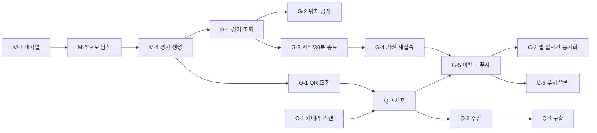

# TODO — 미구현 기능과 작업 분담

현재 상태: 공통 구조·기본 기능은 동작, 핵심 게임 로직은 **계약(인터페이스·DTO·API 경로)과 Mock** 만 있다.
서버 해당 API 는 모두 `501 NOT_IMPLEMENTED` 를 돌려주며, 앱은 개발 빌드에서 `MockGameBackend` 로 화면 흐름을 확인할 수 있다.

## 0. 공통 원칙

- 판정은 서버에서만(앱은 표시만). 클라이언트가 보낸 userId·역할·좌표를 믿지 않는다.
- 서버 기능 구현 = `server/.../game/GameFeatureContracts.kt` 인터페이스 구현 → `ServerDependencies`(Application.kt)에서 `NotImplemented…` 교체. **라우트는 이미 있다.**
- 앱 연동 = 개발자 설정의 "게임 화면 Mock 데이터 사용" 끄기 → `RemoteGameRepository`/`RemoteMatchmakingRepository` 사용.
- 각 작업 완료 시: 서버 테스트 추가, API.md 의 "계약만" 표시 해제, TEST_REPORT.md 갱신.

## 1. 4인 분담안 (추천)

| 담당 | 작업 묶음 | 주 영역 | 선행 조건 |
|---|---|---|---|
| 팀원 A | **M. 매칭 & 경기 생성** | 서버 matchmaking, 앱 매칭 연동 | 없음 (가장 먼저 시작) |
| 팀원 B | **G. 경기 진행·위치 공개·종료/무효 판정** | 서버 game, event, notification | M-4 의 경기 데이터 구조(테이블은 이미 있음) |
| 팀원 C | **Q. QR 체포·호송·수감·구출** | 서버 capture/rescue/qr, 앱 QR 화면 | M-4 (QR 발급), G-1 (경기 조회) |
| 팀원 D | **C. 클라이언트 실기능 & iOS** | 카메라 스캔, 실서버 상태 동기화, iOS, 백그라운드 | Mac 확보(iOS), Q 계약(스캔 결과) |

M·G·Q 는 서버 테이블이 이미 만들어져 있어 **동시에 시작할 수 있다**(서로의 Repository 를 테스트용 데이터로 대신 채우면 됨).

---

## M. 매칭 & 경기 생성 (팀원 A)

| ID | 구현 목표 | 관련 요구사항 | 필요한 클래스 | 관련 API |
|---|---|---|---|---|
| M-1 | 대기열 등록·조회·취소 | FR-01, S-05, D-01 | `MatchmakingService` 구현(`DefaultMatchmakingService`), `MatchmakingQueueRepository`(Exposed, `MatchmakingQueueTable`) | POST/GET/DELETE `/api/matchmaking[/me]` |
| M-2 | 반경 500m 4인 후보 탐색, 동시 매칭 충돌 방지 | FR-01, NFR-P01(≤3초) | `GeoMath.distanceMeters`, 트랜잭션 + `SELECT … FOR UPDATE` (Exposed `forUpdate()`) | — |
| M-3 | 10분 만료 처리(EXPIRED), 대기 중 위치 15초 갱신 반영 | FR-01, 매칭 제한 | 코루틴 스케줄러(Application 범위) | — |
| M-4 | 경기 생성: 4명 중심점(`GeoMath.centroid`), 반경 500m, 감옥=중심 10m, **역할 무작위 2:2**(`SecureRandom` shuffle), `game_players`, `qr_tokens` 발급, `starts_at = now + 30초` | FR-01, FR-06, 규칙 표 | `GameCreator`, `GameRepository`(서버) | — |
| M-5 | 매칭 완료 알림(WebSocket `game_event: GAME_CREATED`) + 앱 `RemoteMatchmakingRepository.ticket` 갱신(폴링 또는 WS) | NFR-P01 | `NotificationService`, 앱 `RemoteMatchmakingRepository` | WS |

- 순서: M-1 → M-2 → M-4 → M-3 → M-5
- 테스트 기준: 같은 위치 4명 등록 시 1개 경기 생성·2:2 역할 / 600m 떨어진 1명은 제외 / 동시에 5명 등록해도 한 사람이 두 경기에 들어가지 않음 / 10분 경과 시 EXPIRED / 대기 응답에 타인 좌표 없음(NFR-S01).

## G. 경기 진행·위치 공개·종료 (팀원 B)

| ID | 구현 목표 | 관련 요구사항 | 필요한 클래스 | 관련 API |
|---|---|---|---|---|
| G-1 | 내 경기·경기 조회(참가자만) | S-08/09/12 | `DefaultGameService.currentGame/getGame` | GET `/api/games/current`, `/api/games/{id}` |
| G-2 | 역할별 위치 공개: READY=4명 최초 위치, PLAYING=경찰 전원/도둑 도둑끼리, 종료 후 403 | 위치 공개 규칙, NFR-S01/S02 | `visibleLocations`, `LocationRepository` 에 `latestForGame` 추가 | GET `/api/games/{id}/locations` |
| G-3 | READY→PLAYING(30초 후), 30분 경과 시 미체포 도둑 있으면 THIEF_WIN | FR-04 | `GameClock`/스케줄러 | — |
| G-4 | 명시적 기권(즉시 CANCELLED/INVALID), **연결 끊김 3분 유예**(WS 끊김 → RECONNECTING → 3분 초과 LEFT → 무효) | 기권·실격, 재접속 | `forfeit`, `ConnectionManager` 연결/해제 훅 | POST `/forfeit`, WS |
| G-5 | 이벤트 기록·조회·푸시(`game_events`, `after=`) | FR-05/07, NFR-P05 | `GameEventRepository`, `NotificationService` | GET `/events`, WS `game_event` |
| G-6 | (Should) 게임 구역 축소 + 양 팀 알림 | FR-05/06 | `ZoneShrinkPolicy` | WS |
| G-7 | (Could) 25km/h 과속 경고 3회 실격, 180초 위치 미수신 실격 | FR-08 | `SpeedChecker`(직전 위치와 거리/시간), 위치 수신 훅 | — |

- 순서: G-1 → G-2 → G-3 → G-4 → G-5 → G-6 → G-7
- 테스트 기준: 도둑 토큰으로 위치 조회 시 경찰 좌표 0건 / 경기 종료 후 조회 403 / 30분 시점 THIEF_WIN / 기권 시 모든 참가자에게 CANCELLED 이벤트 / 2분 끊김 후 재접속은 경기 유지, 3분 초과는 INVALID.

## Q. QR 체포·호송·수감·구출 (팀원 C)

| ID | 구현 목표 | 관련 요구사항 | 필요한 클래스 | 관련 API |
|---|---|---|---|---|
| Q-1 | 내 QR 조회(경기별 고정 토큰) | S-11, QRToken 모델 | `DefaultQrTokenService`, `QrTokenRepository` | GET `/api/games/{id}/qr/me` |
| Q-2 | 체포: 경찰만, 대상이 같은 경기 ACTIVE 도둑, 경찰 1명당 호송 1명(`ESCORT_LIMIT`), 마지막 도둑이면 즉시 POLICE_WIN | FR-02, D-03 | `DefaultCaptureService` | POST `/captures` |
| Q-3 | 수감 판정: 위치 수신 때마다 호송 쌍(경찰·도둑) **둘 다** 감옥 10m 이내면 JAILED | 수감 규칙 | 위치 수신 훅 → `JailChecker`(`GeoMath.isWithinRadius`) | — |
| Q-4 | 구출: 미체포(ACTIVE) 도둑만, 대상 JAILED 만, ESCORTED 는 거부 | FR-03 | `DefaultRescueService` | POST `/rescues` |
| Q-5 | `requestId` 중복 요청 시 첫 결과 재반환, 이벤트 기록(`PLAYER_CAPTURED/JAILED/RESCUED`) | NFR-A03, FR-07 | 처리 결과 저장 테이블(V2 마이그레이션) | — |

- 순서: Q-1 → Q-2 → Q-3 → Q-4 → Q-5
- 테스트 기준: 다른 경기 토큰 `OTHER_GAME` / 위조 토큰 `INVALID_TOKEN` / 두 번째 동시 체포 `ESCORT_LIMIT` / 도둑이 스캔하면 체포 거부 / 호송 중 구출 `TARGET_ESCORTED` / 한 명만 10m 안이면 수감 안 됨 / 같은 requestId 두 번 → 한 번만 처리. (`MockGameBackendTest` 가 규칙 예시)

## C. 클라이언트 실기능 & iOS (팀원 D)

| ID | 구현 목표 | 관련 요구사항 | 필요한 클래스 |
|---|---|---|---|
| C-1 | 카메라 QR 인식(Android: CameraX + ML Kit Barcode(on-device, 무료) 또는 ZXing) | S-10, NFR-P04 | `expect fun QrScannerView(onScanned)` + androidMain 구현, `QrScanScreen` 의 placeholder 교체 |
| C-2 | 실서버 상태 동기화: WS `game_event` 수신 → 지도·상태 갱신, 앱 복귀 시 `/games/current` 로 복원, 누락 이벤트 `after=` 재조회 | 2.4 앱 복귀, NFR-A02 | `GameMapViewModel`, `RemoteGameRepository`, `RealtimeRepository.events` |
| C-3 | iOS 빌드 확인(Mac) → 지도(MapLibre iOS 또는 MapKit `UIKitView`), QR 이미지(CoreImage), 카메라(AVFoundation), 백그라운드 위치(`UIBackgroundModes=location`) | iOS 지원 | `iosMain/platform/*` TODO 들 |
| C-4 | Android 백그라운드 위치 실기기 검증(화면 꺼짐, Doze, 배터리 최적화 예외 안내), 경기 시작 시 자동 시작/종료 시 자동 정지 | 15초 갱신 | `LocationTrackingService`, `BackgroundLocationController` |
| C-5 | 알림(FCM/APNs) — 매칭 완료·체포·구출·구역 축소 | 최종 이벤트 알림 | NotificationService(서버) + 앱 수신 |
| C-6 | 접근성 실기기 점검(TalkBack/VoiceOver, 글자 200%) | UI 보고서 6장 | — |
| C-7 | 로그아웃 시 서버 토큰 폐기(`POST /api/auth/logout`, 서버 포함) | 보안 | `AuthRepositoryImpl.logout`, 서버 auth |

- 순서: C-1 → C-2 → C-4 → C-3 → C-5 → C-6 → C-7
- 테스트 기준: 실제 QR 을 1초 내 인식 / 앱을 껐다 켜도 진행 중 경기로 복귀 / 화면 꺼진 상태 5분 동안 서버 수신 간격 기록 / iOS 시뮬레이터에서 로그인→홈→지도.

## 2. 다른 기능과의 의존성

## 3. 기타 TODO (코드 안 `TODO(...)` 주석 위치)

| 항목 | 위치 |
|---|---|
| 서버 토큰 폐기(로그아웃) | `composeApp/.../data/repository/RepositoryImpls.kt` |
| 매칭 상태 폴링/WS | `RemoteMatchmakingRepository` |
| 푸시 알림 | `server/.../notification/NotificationService.kt` |
| iOS 지도 / QR 이미지 / 백그라운드 위치 / 알림 권한 상태 | `composeApp/src/iosMain/...` |
| 카메라 QR 인식 | `presentation/qr/QrScreens.kt` |
| 위치 데이터 보존 기간·삭제 배치 | DATABASE.md 저장 정책 |
| 앱 아이콘·스플래시 디자인 | `androidApp/src/main/res/drawable/ic_launcher.xml`(임시) |
| Release 서명·난독화 설정 | `androidApp/build.gradle.kts` |
