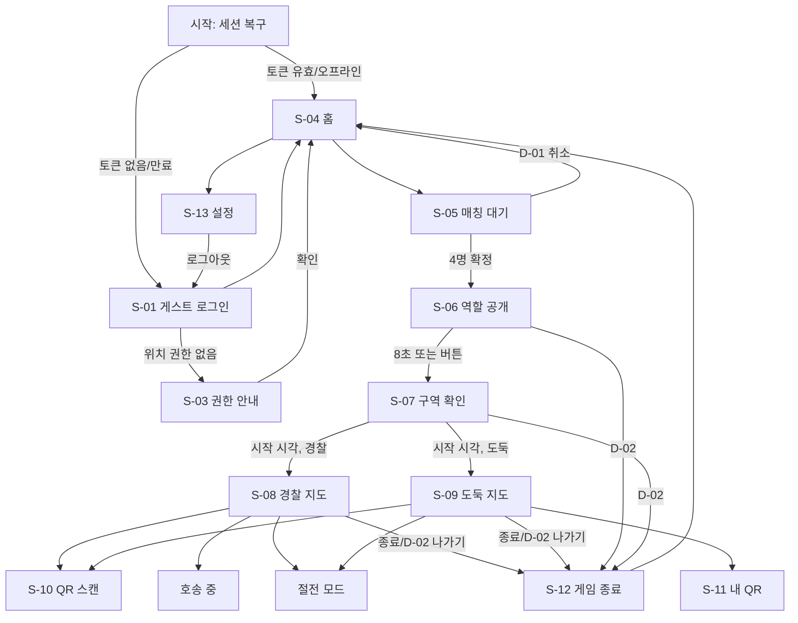

# UI_STRUCTURE — 화면 구조

UI 설계 보고서(팀 넷트워크, 2026-11-06)의 다크 팔레트·역할 색·화면 ID·상태 정의를 따르되, 최신 요구사항으로 다음을 바꿨다.

| 보고서 | 현재 구현 | 이유 |
|---|---|---|
| S-01 닉네임+비밀번호 로그인, S-02 회원가입, D-04 | 닉네임 게스트 로그인만 (S-02·D-04 제외) | 최신 요구사항 |
| 시스템 밝게/어둡게 테마 | 다크 테마 고정 | "기본 테마 다크" 요구 |
| 절전 모드 미제공 | 절전 모드 화면 추가 | 이번 구현 화면 목록 12번 |
| 점수·랭킹 | 미제공 | 최신 요구사항 |
| 감옥 반경, 위치 공개, 준비시간 | 10m / 경찰=전원·도둑=도둑끼리 / 30초 | 최신 요구사항 |

## 공통 규격 (`presentation/theme/Theme.kt`, `presentation/components/CommonComponents.kt`)

| 항목 | 값 |
|---|---|
| 배경 / 표면 | `#0A0E16` / `#121A28` |
| 본문 / 보조 글자 | `#E6EDF7` / `#A7B4C8` |
| 경찰(주조색) | `#2563EB` — 글자색으로 쓰지 않고 버튼·도형 배경 + 흰 글자 (명암비 3.74:1 미달 대응) |
| 도둑 | `#FB923C` |
| 감옥·게임 오브젝트 | `#FACC15` (사각형 + "감옥" 라벨) |
| 정상 / 오류 | `#4ADE80` / `#F87171` |
| Mock 표시 | 보라 `#C084FC` 배지 (`MockBadge`) |
| 글자 | 40sp(역할·승패) / 28sp(제목·타이머) / 16sp(버튼·본문) / 14sp(안내) / 12sp(캡션), 모두 sp 단위 |
| 여백 | 좌우 16dp, 요소 8dp, 구획 20dp |
| 터치 | 홈 주 버튼 72dp, 경기 주 버튼 64dp, 보조 48dp 이상 |

공통 상태 컴포넌트: `LoadingState`(liveRegion), `ErrorState`(원인+다음 행동 버튼), `EmptyState`, `NoticeBanner`(부분·지연 상태), `ConfirmDialog`(D-01/D-02/D-03), `ScreenContainer`(최대 폭 600dp — 태블릿·가로 화면 대응), `StatusIndicator`(색+문구, 색만으로 구분하지 않음), `RoleBadge`("경찰"/"도둑" 글자).

접근성: 제목에 `heading()`, 지도에 마커 요약 `contentDescription`(`GameMapState.accessibilitySummary`), 확대/축소 버튼 설명, 입력 오류 `error()` semantics, 로딩·오류 liveRegion. 글자 확대 시 스크롤 가능한 레이아웃. (TalkBack 실기기 검증은 미실시)

## 내비게이션 (`presentation/navigation/AppNavHost.kt`)

스택 패턴(하단 탭·드로어 없음). 화면은 콜백만 노출하고 `navigate` 는 AppNavHost 에서만 호출한다.

뒤로가기: 매칭 대기 → D-01, 역할 공개·구역 확인·경기 지도 → D-02, QR·호송·절전 → 지도로, 결과 → 홈. (iOS 는 시스템 뒤로가기가 없어 화면의 [나가기] 버튼 사용)

## 화면별 구조

| # | 화면 (ID) | Composable / 파일 | ViewModel | UI 상태 | 데이터 |
|---|---|---|---|---|---|
| 0 | 시작 | `LaunchScreen` / `login/LoginScreens.kt` | `LaunchViewModel` | Restoring / Failed + 이벤트 GoHome·GoLogin | **실제 서버** `GET /users/me` |
| 1 | 게스트 로그인 (S-01) | `LoginScreen` | `LoginViewModel` | `LoginUiState(nickname, isSubmitting, fieldError, submitError)` | **실제 서버** `POST /auth/guest` |
| 2 | 권한 안내 (S-03) | `PermissionScreen` / `permission/` | `PermissionViewModel` | 권한별 GRANTED/DENIED/NOT_DETERMINED | 실제 OS 권한 |
| 3 | 홈 (S-04) | `HomeScreen` / `home/` | `HomeViewModel` | `HomeUiState(user, server, realtime, location, …)` | **실제 서버** health·me·locations, **실제 WebSocket**, **실제 GPS/테스트 좌표**, 실제 지도 |
| 4 | 매칭 대기 (S-05) | `MatchmakingScreen` / `matchmaking/` | `MatchmakingViewModel` | Locating / Waiting(count, elapsed, dropped) / TimedOut / Failed | 위치=실제, 매칭=**Mock** |
| 5 | 역할 공개 (S-06) | `RoleRevealScreen` / `prepare/Prepare.kt` | `GameSessionViewModel` | Loading / Failed / ZoneUnavailable / Ready(game, me, positions, millisToStart, partial) | **Mock** |
| 6 | 게임 구역 확인 (S-07) | `ZoneConfirmScreen` | `GameSessionViewModel` (같은 key 공유) | 위와 같음 | **Mock** + 실제 지도 |
| 7 | 경찰 게임 지도 (S-08) | `GameMapScreen(expectedRole=POLICE)` / `game/GameScreens.kt` | `GameMapViewModel` | `GameMapUiState(game, me, myLocation, others, stale, errors, remaining)` | 경기=**Mock**, 내 위치·전송=**실제** |
| 8 | 도둑 게임 지도 (S-09) | `GameMapScreen(expectedRole=THIEF)` | `GameMapViewModel` | 위와 같음, 하단 [내 QR]·[동료 구출 스캔] | 위와 같음 |
| 9 | QR 스캔 (S-10) | `QrScanScreen` / `qr/QrScreens.kt` | `QrScanViewModel` | `ScanPhase` Ready/Verifying/Accepted/Rejected/Unconfirmed + D-03 | **Mock** 스캔 버튼 (카메라 인식 TODO) |
| 10 | 내 QR (S-11) | `MyQrScreen` | `MyQrViewModel` | Loading / Failed / Ready(token, myStatus) | **Mock** 토큰, 실제 QR 이미지(Android) |
| 11 | 호송 중 | `EscortScreen` / `game/` | `EscortViewModel` | escorted, 감옥까지 거리(실제 GPS로 계산), isInsideJail | **Mock** + 실제 위치 |
| 12 | 절전 모드 | `PowerSaveScreen` | `PowerSaveViewModel` | 남은 시간, 마지막 전송, 백그라운드 on/off | 실제 Foreground Service(Android) |
| 13 | 게임 종료 (S-12) | `GameResultScreen` / `result/` | `GameResultViewModel` | Loading / Failed / Ready(game) | **Mock** |
| 14 | 설정 (S-13) | `SettingsScreen` / `settings/` | `SettingsViewModel` | 계정, 서버 주소, health, WebSocket 연결/해제/테스트, 권한, 백그라운드, 개발자 모드 | **실제** |

### 보고서 상태 정의 대응 (예: S-05 매칭 대기)

| 보고서 상태 | 구현 |
|---|---|
| 기본 "매칭 중 · 2/4 명", 진행 바, 경과/10분 | `Waiting` + `LinearProgressIndicator` |
| 로딩 "현재 위치 확인 중" | `Locating` + `LoadingState` |
| 비어 있음 "10분 내 참가자를 찾지 못했어요" [다시 찾기][홈으로] | `TimedOut` |
| 오류 권한·GPS·서버 → "위치 설정 열기"/"다시 시도" | `Failed(needsLocationSettings)` |
| 부분 "참가자가 나가 3/4 명이에요" | `Waiting(dropped=true)` + `NoticeBanner` |

경기 지도: 비어 있음 "아직 표시할 위치 정보가 없습니다", 오류/부분 "오프라인 · 이전 정보 기준 · 마지막 위치 확인: HH:mm:ss"(30초 이상 미수신), 내 위치 오류 배너. QR: "서버에서 확인 중", 사유별 거부 문구, 통신 실패 시 "서버 판정 대기·미확정"+[다시 확인]. 결과: "세부 기록이 없습니다", [다시 조회].

## Mock 모드와 실제 모드 구분

- **개발 빌드**(Android debug, iOS Debug)에서만 Mock 사용 가능. 설정 → 개발자 테스트 모드:
  - "테스트 좌표 사용" — GPS 대신 지정 좌표(source=MOCK 으로 서버 전송, 즉시 적용)
  - "게임 화면 Mock 데이터 사용" — 매칭~결과 화면을 `MockGameBackend` 로(기본 ON, **앱 재시작 후 적용**). 끄면 실제 서버 API 호출 → 현재 501 오류가 그대로 표시됨
  - "Mock 역할 지정" — 무작위/경찰/도둑
  - "서버 주소 변경" — Cloudflare 임시 URL 등
- Mock 화면에는 보라색 `MOCK` 배지가 붙고, 경기 지도에는 [Mock 조작] 패널(감옥 도착, 승패 시뮬레이션)이 있다. 이 버튼들은 실제 판정이 아님을 화면에 명시한다.
- 릴리스 빌드에서는 개발자 메뉴가 숨겨지고 항상 실제 GPS·실제 서버를 사용한다.
